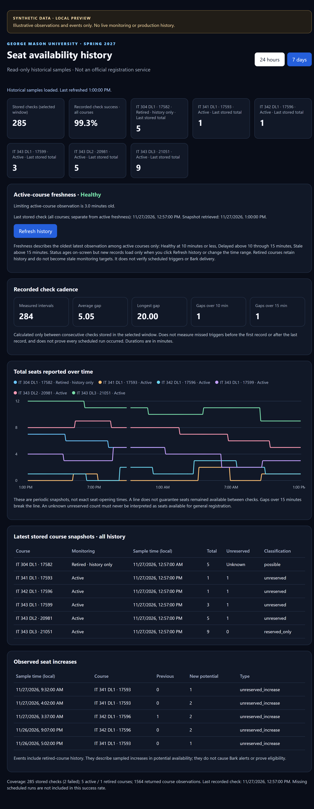

# GMU Seat Monitor

[](https://github.com/BirdIsOffline/gmu-seat-monitor/actions/workflows/ci.yml)

Read-only course availability monitoring with reservation-aware iPhone alerts and authenticated historical analytics.

The monitor checks exact sections in the public GMU catalog, compares each with its previous observation, and sends Bark alerts when potentially available seats increase. GitHub Actions runs the monitor through an external five-minute dispatcher. Cloudflare Workers store sanitized observations in D1 and serve the historical dashboard.

## Architecture

| Component | Responsibility |
| --- | --- |
| [Python monitor](monitor.py) and [health runner](health_runner.py) | Exact section matching, reservation parsing, change detection, notification delivery and lookup health |
| [GitHub Actions](.github/workflows/) | Gated monitoring, cached comparison state, bounded history submission and separate offline CI |
| [Ingestion Worker](cloudflare/) and D1 | Authenticated validation, atomic storage and chronological opening-event calculation |
| [Dashboard Worker](dashboard/) | Token-protected history API, section cards and charts, coverage and freshness |

**Stack:** Python 3.12, Requests, SQLite, GitHub Actions, Cloudflare Workers and D1, JavaScript, Node.js 24 and Bark. Miniflare/workerd provides local Worker/D1 integration tests.

See the [system diagram](docs/SYSTEM_DIAGRAM.md) and [design decisions](docs/ARCHITECTURE.md).

## Section identity and lifecycle

All six active Spring 2027 sections are deployed and verified; IT 304 DL1 remains retired with its history preserved.

| Section | CRN | Status |
| --- | --- | --- |
| IT 304 DL1 | 17582 | Retired; history only |
| IT 341 DL1 | 17593 | Active |
| IT 342 DL1 | 17596 | Active |
| IT 343 DL1 | 17599 | Active |
| IT 343 DL2 | 20981 | Active |
| IT 343 DL3 | 21051 | Active |
| IT 304 DL2 | 21146 | Active |

Comparison state and dashboard identities use CRNs; history uses `(term, crn)`. Sections sharing a course number retain independent observations and alerts. CI checks monitor/dashboard configuration parity.

Retirement stops polling and alerts while preserving state, observations and events. Status changes are explicit. See [course lifecycle](docs/TERM_LIFECYCLE.md) for archival and the single-term boundary.

## Notifications and analytics

- Known reserved-only seats do not trigger alerts. Explicit unreserved counts are capped by the total; missing reservation metadata remains uncertain, and conflicting or unparseable restrictions suppress alerts.
- Increasing candidate counts trigger notifications identifying section and CRN. Unchanged or decreasing counts stay silent while comparison state survives.
- Actionable notifications use `sound=alarm`, `call=1`, `level=critical` and `volume=10`.
- The dashboard supports seven independent identities in 24-hour and seven-day views. All six active sections need valid recent observations for healthy aggregate freshness; retired history is excluded from that calculation.

## Dashboard preview

[](docs/assets/dashboard-synthetic.png)

*Rendered locally with synthetic observations and events using the earlier six-identity configuration; no live monitoring or production history.*

## Verified results

[Main CI run 46114809008](https://github.com/BirdIsOffline/gmu-seat-monitor/actions/runs/46114809008) passed **296 tests with zero failures or skips**: 232 Python, 30 Worker/D1 integration and 34 dashboard tests. Coverage includes section isolation, reservations, duplicate suppression, retries, transaction rollback, delayed observations, interruption, locking and rendering.

The deployed seven-identity dashboard passed authenticated HTTP 200 and unauthorized HTTP 401 checks, both chart ranges, six-section freshness and exact preservation of baseline history. IT 304 DL2 also passed natural monitoring and historical ingestion checks. Missing-data display was tested in the browser without production writes. The [dashboard verification record](dashboard/README.md#verification) describes chart and event-rendering limits.

A controlled Bark alarm test rang for approximately 20 seconds on the iPhone. It tested notification playback, not a genuine seat opening. See the [notification contract](CLOUD_SETUP.md#bark-notification-contract).

## Run offline

Use Linux/POSIX, Python 3.12 and Node.js 24 for the full suite:

```bash
python -m pip install -r requirements.txt
npm ci --prefix cloudflare
python -m unittest discover -s tests -v
npm test --prefix cloudflare
node --test dashboard/worker.test.mjs
```

Tests use mocks, disposable databases and loopback connections. Installation accesses package registries; tests do not contact GMU, Bark or hosted Cloudflare services. See [local validation](docs/LOCAL_DEMO.md) for demos and Windows support.

## Operations and limitations

- Live polling requires permission and the `GMU_POLLING_APPROVED` gate. Dispatch is best-effort; brief openings between samples can be missed. Cache loss can reset duplicate suppression.
- Seat counts do not establish registration eligibility. The monitor does not access student accounts or register for classes. Phone delivery depends on Bark, iOS permissions and device settings.
- An ephemeral runner can lose observations before D1 acknowledges them. No production recovery-time or recovery-point guarantee has been established.
- History has no automatic pruning. The dashboard is single-term and returns at most 16,000 samples and 50 events per view. A Git push does not deploy either Worker.

[Operations](CLOUD_SETUP.md) · [History design and recovery](docs/CLOUDFLARE_DURABLE_HISTORY.md) · [Dashboard](dashboard/README.md) · [Security](SECURITY.md) · [Limitations and extensions](docs/ROADMAP.md)
