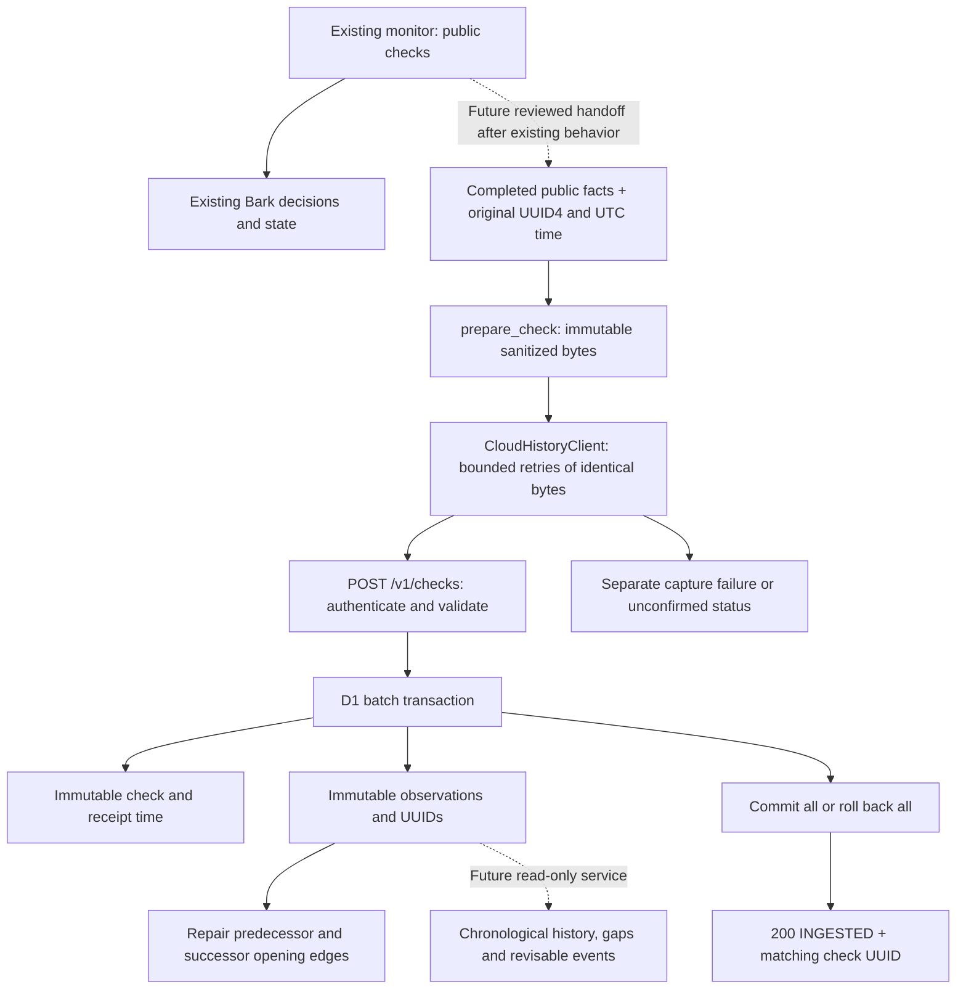

# Cloudflare-first durable historical ingestion

This milestone chooses **direct atomic D1 ingestion with a chronological timeline**.
It adds no inbox, scheduled processor, queue, persistent Linux host or paid resource.
It is implemented and tested offline on `feature/cloudflare-history-inbox`, based
on fetched `origin/main` at `2e4af5b` (merged PR #4). Staging verification from the
previous milestone is operator-reported; this change does not access that service.
Production monitoring, Bark, cron-job.org and the operational workflow remain
unchanged at that milestone. The subsequent
[structured producer and submission adapter](LIVE_HISTORY_ADAPTER.md) now exists
locally, disabled by default. The operator reports successful staging deployment
of 0002 and its matching Worker. This work does not re-verify or change staging;
actual history requires a separate, dedicated production environment.

This document supersedes the cloud ordering/activation recommendations in
[CLOUD_HISTORY.md](CLOUD_HISTORY.md) and [HISTORY_RELIABILITY.md](HISTORY_RELIABILITY.md).
The latter remains the reference for the optional POSIX SQLite outbox. That
outbox is retained and tested, but is unnecessary for this Cloudflare-first path.

## Decision: direct ingestion instead of a pending inbox

The actual workload is two course samples per five-minute completed check,
approximately 288 checks and 576 observations per day. Historical processing is
small, deterministic SQL with no external side effects. Normal monitoring and
Bark already handle live notifications independently.

| Option | Benefit | Cost / limitation |
| --- | --- | --- |
| Existing strict direct append | One atomic receipt/projection transaction | Rejects delayed samples after a newer sample; concurrent writers can lose valid historical capture |
| D1 pending inbox + scheduled drain | Receipt can commit while a separate projection is broken; can buffer known pending samples | Extra payload/state tables, retry/poison states, drain scheduling, atomic claims/checkpoints and operational backlog. No finite delay orders unseen arrivals; still needs a late-sample policy. Receipt fails when D1 itself is unavailable |
| **Selected: direct receipt + chronological neighbour repair** | One transaction, accepts delayed samples, idempotent and race-free; projection work bounded per sample | Projection failure prevents this transaction's receipt; chronological opening events can change when delayed facts arrive |

An inbox could improve acceptance during **projection-specific** faults. It does
not improve capture during a D1/Cloudflare outage, source crash before submission,
or loss of an unsubmitted ephemeral runner. Here the projection is only two
adjacent comparisons per sample. The extra independently operated processor is
not justified by the current workload. Reconsider an inbox if projection becomes
expensive, needs independent availability, or gains external side effects.

There is no promise of literal arrival in timestamp order. **Chronological
processing means that the committed projection equals processing all currently
stored samples in ascending observation time**, for each `(term, crn)`. Receipt
order and integer row IDs are never used to choose the preceding sample. Waiting
for all possible older observations would require a trusted producer watermark
or sequence-completion contract that this system does not have.

## Data flow and durability boundary



1. The future caller assigns a random UUID4 **once** to the original completed
   check. It supplies aware sample time, duration, successful course facts and an
   allowlisted failure code for a partial/empty failed check. No invented samples
   for failed lookups; all rows in a check share its sample timestamp.
2. `prepare_check` copies and sanitizes whitelisted public fields. No credentials,
   student data, raw response bodies or free-form error text enter the protocol.
   Retain the `PreparedCheck` bytes for retries; never make another GMU request or
   a new UUID/timestamp to repair a historical failure.
3. The Worker fails closed on missing/invalid server configuration, compares
   bearer-secret digests, bounds reads to 64 KiB, validates every field and limits
   checks to 50 distinct courses. There is one fixed POST route, no arbitrary SQL,
   read endpoint, redirects, CORS permission or outbound Worker fetch.
4. Canonical SHA-256 binds the UUID to all validated check facts, including row
   order normalization. Changed facts with the same UUID cause 409. An exact or
   semantically reordered retry has no additional observations or event changes.
5. A **single `DB.batch()`** contains two statements: check insert/hash-checked
   upsert and a JSON-rowset observation insert excluding existing check/course
   keys. Ten bound parameters total; no dynamic user SQL. Observation triggers
   validate course identity/tied timestamps and maintain chronological edges
   under D1's transaction write lock. Concurrent handlers do no pre-read or
   read/compare/write outside that transaction.
6. An observation becomes **durable when this entire D1 transaction commits**,
   under D1's durability contract. Authentication, parsing, Worker execution,
   request transmission and local preparation do not constitute durable receipt.
   There is no `waitUntil` receipt, pending state or later processing boundary.
7. `200 {"code":"INGESTED","check_id":"original UUID"}` is sent only after
   batch success. The Python client accepts only that exact matching
   acknowledgement. A lost response or timeout is **unconfirmed**: D1 may already
   have committed. Retry original bytes/UUID; never assume rollback from a timeout.
   If commit succeeds but the producer dies, those observations remain in D1
   without requiring any producer filesystem or follow-up processing.

`checks.received_at_utc` records D1's first receipt time, independently of sample
time, and never changes on a duplicate. It is null for pre-migration checks because
their original receipt times are unknown. New observations have deterministic
UUID5 identities: namespace = check UUID4, name = ASCII `term:crn`, matching
Python `uuid.uuid5(uuid.UUID(check_id), f'{term}:{crn}')`. This SHA-1 use defines a
UUID, not authentication. `check_id` plus course remains the replay key. Legacy
observations receive UUID4 identities once during migration; preserve those in
backups. Integer observation IDs and event IDs are database-local identifiers.

## Chronological projection, delayed samples and missing coverage

Inserting sample `x` between chronological neighbours `p` and `n` replaces only
`p -> n` with `p -> x` and `x -> n`. Each edge generates an opening only if both
sample totals are known and the candidate count increases. Classification and
potential-count rules are unchanged. Unknown samples break an inference; they
do not become a zero baseline. Reserved-only increases do not generate openings.
The first sample has no preceding edge. A late first sample can create an opening
at its successor. Everything happens inside the receipt transaction.

For example, receiving `00:00=0`, `00:10=2` initially produces one sampled
increase `0 -> 2`. A delayed `00:05=1` atomically replaces it with `0 -> 1` and
`1 -> 2`. A delayed unknown at `00:07` then removes the inferred `1 -> 2` edge.
The original observations remain unchanged. These are **revisable historical
projections**, never notification instructions. No historical event emits Bark.
Readers should use the destination observation UUID as an event identity and
refresh affected windows; don't consume increasing integer event IDs as a durable
append-only feed. Event removal must also be reflected in dashboard caches.

Distinct UUIDs at the **same timestamp for the same course** return 409, even if
counts match. Their order is ambiguous. Exact UUID retries remain accepted; ties
across different courses are allowed. Changed subject/number/section for an
existing term/CRN also returns 409. A multi-course conflict rolls back the whole
check, including independent rows. Diagnose with retained original facts and
reviewed inspection; there is no automatic skip, timestamp rewrite or UUID reset.

There is no lower lateness cutoff, watermark or full-course rebuild. All retained
history can accept an older sample. Missing samples do not block later ones. A
read service must expose timestamp gaps and failed checks, rather than claiming
continuous coverage: compare neighbouring timestamps to the expected five-minute
cadence, flag large gaps, and label an inferred increase across a gap as spanning
that interval. Availability/opening time is sampled, not exact. A failed check
with no rows is health evidence, not a synthetic zero or unknown observation for
every course. Backfill only original surviving facts; never re-query GMU to
reconstruct past data. False/future source timestamps still require operator
investigation; the API validates format/calendar, not clock synchronization.

## Bounded work and free-tier planning

There is no drain backlog or scheduled processor. Each request processes at most
50 observations, with indexed predecessor/successor/identity lookups, at most one
edge deletion and two event insertions per sample. The bulk insert keeps D1 API
statement count at two even at the protocol cap. Courses use a unique covering
order key `(term, crn, observed_at_utc)`; duplicate detection uses the existing
unique check/course key. Processing does not scan or replay the entire timeline.
Administrative migrations/large imports have separate budgets.

The Python client defaults to three attempts, fixed connect/read inactivity
limits and short exponential backoff, with at most five attempts configurable.
408/429/5xx and transport/acknowledgement failures retry; permanent failures do
not. These limits do not impose a total HTTP wall-clock deadline, and the client
does not implement distributed throttling or server `Retry-After` scheduling.
Any future workflow must run historical submission separately under a hard
process deadline and a bounded rate budget. Do not sleep/poll/refetch courses to
clear history errors. There is no new cron trigger in `wrangler.toml`.

At current cadence, plan for about 288 Worker requests/day plus retries, 288
check rows, 576 observation rows, UUID/time indexes, receipt indexes and event
changes. Duplicate upserts also write; delayed samples can delete/recreate up to
two event edges. **864 base rows/day is not a billable-write estimate**: measure
D1 rows read/written and Worker CPU with real staging usage before activation.
Common planning ceilings are 100,000 Worker requests/day, 10 ms free HTTP Worker
CPU, 50 D1 queries per free Worker invocation, 5 million D1 rows read/day,
100,000 rows written/day, and 5 GB total free D1 storage (with per-database limits).
These are not account-verified entitlements. Check current
[Workers limits](https://developers.cloudflare.com/workers/platform/limits/),
[D1 limits](https://developers.cloudflare.com/d1/platform/limits/) and
[D1 pricing](https://developers.cloudflare.com/d1/platform/pricing/) before use.
Miniflare tests do not prove live CPU/quotas/latency. The 50-course cap is an input
bound, not an assurance that every such request fits a free CPU budget.

Storage is unbounded here: approximately 105,120 checks and 210,240 observations
per year at two courses. Monitor growth; throttle historical imports and leave
headroom for other workloads. No pruning, automatic paid upgrade or resource
creation is implemented. Retention must preserve original replay identities,
course baselines and backup/rebuild ability before any deletion policy is added.

## Failures, recovery and remaining data loss

| Failure | Result and recovery |
| --- | --- |
| D1 error, constraint interruption during projection, quota exhaustion | Transaction rolls back; 503 for service/storage errors, 409 for documented conflicts. Retry transient errors with original body. No half-receipt or half-repaired graph |
| D1 commits, HTTP acknowledgement lost, producer interrupted | Original UUID retry acknowledges existing data; processing was already complete. If body is lost but commit succeeded, data remains in D1 |
| Invalid/auth failure/permanent conflict | No receipt. Separate historical failure status; diagnose before manual retry. No monitoring/Bark retry |
| All client attempts fail | `success=False` plus fixed code and attempts; completed-capture boundary logs `Historical capture unconfirmed`. Persist/report separately from monitoring health. Do not claim server absence from lack of acknowledgement |
| Preparation or unexpected client error | Best-effort boundary catches and reports a fixed code without raw exception, body or secret. Normal monitor result is untouched |
| Source ends before D1 receipt, runner disappears, scheduler/lookup never runs | **Potential permanent loss.** D1 cannot recover facts it never received. Caches, logs and expiring Actions artifacts are not a durable capture guarantee |
| Point-in-time restore or database loss | RPO is the last surviving D1 recovery point/export and any retained original source. Acknowledged records after that point may be absent. Replay original UUIDs/facts if available; surviving rows deduplicate and missing older rows repair neighbours |
| Missing source archive, deleted IDs or incomplete backups | No guaranteed complete recovery. Never fabricate samples from current seat state or regenerate UUIDs |

There is no independent durable source in the deployed topology described by the
operator. This design guarantees neither lossless capture nor exactly-once
delivery. It provides atomic durable effects for accepted observations and
idempotent retry while IDs are retained. An inbox in the same D1 would not close
the pre-Cloudflare loss window. If preserving every completed sample through a
Cloudflare outage becomes mandatory, an independent durable source is required.

For restore/replay, stop historical writers, preserve the affected database and
original exports, restore into an isolated non-production target, then replay
retained original bodies (preferably sorted by sample time to minimize repairs).
Check UUIDs, observation UUIDs, course timelines, gaps, statuses and event edges
before cutover. New UUID5 observation identities are reproducible across a fresh
rebuild; legacy UUID4 mappings need a database export to preserve their exact
identity. Avoid replaying renamed or edited facts. The optional old POSIX outbox
can replay its original retained bodies but still applies its stricter local
frontier policy; direct submission can backfill older retained facts without
using that outbox. Nothing in this change automatically restores a live database.

## Schema migration, safe staging and rollback (future operator work)

Only `0002_ordered_timeline.sql` is new; `0001_history.sql` is unchanged. It adds
receipt time and its index, observation UUIDs and a unique UUID index, replaces
the course time index with a unique chronological index, removes strict append
ordering, installs immutable-update guards, and replaces the opening trigger
with bounded neighbour repair. Existing rows/events/counts remain intact;
legacy receipt time stays unknown. Existing retries remain valid, including
legacy observations with migration-assigned UUIDs. No pending tables are added.

**None of the following staging operations were performed by this milestone.**
Do not target the existing staging or recovery-test database during local testing.
The checked-in Wrangler file retains its placeholder local DB ID and no routes.

1. Independently review code, migration, safety tests and plan budgets. Inventory
   the actual deployed schema, migration ledger and Worker/configuration revisions
   out of band; don't assume the local placeholder configuration describes it.
2. Arrange a maintenance window for historical writers only. Preserve an export
   plus its schema/migration ledger and Worker revision. Validate restore and
   foreign-key integrity on a separately authorized disposable non-production
   target. Check there are no pre-existing course/time ties or inconsistent course
   identities before adding the unique index.
3. Pause all historical writers and apply migration 0002 to that isolated target
   first, using a separately configured explicit binding. Validate populated
   migration, duplicate/changed UUIDs, concurrent writes, delayed/unknown samples,
   interrupted projection, restart and replay. Measure request CPU, read/write
   counts and growth; don't create paid resources.
4. Under separate deployment authorization, pause staging historical writers,
   export/check recovery point again, apply 0002 once via the migration ledger,
   then deploy the matching Worker. Keep ingestion paused during the schema/code
   transition. New code on 0001 fails unavailable; mixed writer versions are not
   supported. The POST protocol/acknowledgement stays compatible with the existing
   Python client, but an old Worker does not supply observation UUIDs.
5. Verify only with synthetic data and existing agreed staging controls. Resume
   staging writers after acceptance checks. Production integration and any
   operational workflow changes require their own reviewed milestone.

**Rollback:** pause historical writers first. Do not simply roll back the Worker
against schema 0002: the old insert omits UUIDs and its ordering semantics differ.
Do not drop the new constraints/columns or run an unreviewed reverse migration.
Export the current database (including newly accepted delayed facts), preserve
both Worker versions and receipts, and roll back the **matched pre-migration DB
snapshot plus Worker revision** on an isolated target. Cut over only after
validation. Data accepted after that snapshot needs preserved original source
or export for recovery; the old strict endpoint cannot replay interleaved older
facts. Prefer a forward fix or a separately reviewed sorted rebuild. Historical
submission can remain disabled while ordinary monitoring continues unchanged.

## Operational monitoring and future producer/dashboard

Use separate historical-capture health, never Bark seat alerts. A future adapter
must report `IngestionResult` (success/code/attempts) in a separate historical step
summary and return nonzero for unconfirmed capture. Do not replace or rerun the
monitoring job result. Missing historical execution must also be detectable;
absence of error logs is not evidence of capture.

Watch Worker 401/409/429/5xx rates, fixed `history_ingestion_conflict` and
`history_ingestion_unavailable` logs, client exhausted retries, capture failure
counts, receipt age, sample lag/future timestamps, missed course samples, D1
read/write/storage quotas and restore drill outcomes. The Worker logs no bodies,
authorization, SQL or raw exceptions. D1 cannot record its own outage reliably;
the separate runner history summary and service metrics must signal it.

Example read-only operational queries (bind parameters; use restricted operator
access, not an ingestion endpoint):

```sql
-- Indexed latest receipt; null for checks predating migration.
SELECT received_at_utc FROM checks
WHERE received_at_utc IS NOT NULL ORDER BY received_at_utc DESC LIMIT 1;
-- Indexed window, rather than a whole-history scan every five minutes.
SELECT status, count(*) FROM checks WHERE received_at_utc >= ? GROUP BY status;
-- Most recent facts by sample time, never insertion ID.
SELECT observation_uuid, observed_at_utc, classification, potential_available
FROM observations WHERE term = ? AND crn = ?
ORDER BY observed_at_utc DESC LIMIT 1;
```

The [opt-in adapter](LIVE_HISTORY_ADAPTER.md) supplies facts **from the original
successful lookup**, with capture failures isolated from notification/state
handling. It remains disabled pending review and rollout authorization. Preserve original check UUID/time and completed
course results, including partial failures; don't parse human logs, use
`seat_state.json` as a complete check, or make additional lookups. A separate
bounded process can prepare once and call `persist_best_effort(client, prepared)`;
`capture_completed_best_effort(client, check_id, time, duration, facts, ...)`
also contains preparation failures and reports unconfirmed capture. Hold the
same prepared bytes for later retries; if facts change a new call is not a retry.
An opt-in HTTPS client gets only the ingestion bearer token through future secret
configuration, with no GMU/Bark/account credentials. Merely setting history
variables described in this older guide does not activate the new adapter; it
requires separate capture and submission opt-ins plus dedicated production
endpoint/token configuration. Best-effort artifacts may
help an operator replay surviving data but cannot close the runner loss window.

A future separately authorized read-only Worker can bind this same D1 and serve
fixed, parameterized, bounded, authenticated timeline/health/event queries. Keep
the ingestion secret and D1 credentials out of the browser. Paginate timelines
by course and sample time, use UUIDs for identities, fetch latest by time, expose
classification/unknown/gap information, and invalidate historical event caches
when older receipts arrive. No dashboard or public read API is added here.

## Offline verification

```bash
.venv/bin/python -m unittest discover -s tests -v
.venv/bin/python -m compileall -q monitor.py setup_bark.py health_runner.py seat_history.py demo_history.py cloud_history.py history_outbox.py tests cloudflare/test
node --check cloudflare/src/worker.js
node --check cloudflare/test/worker.test.js
node --check cloudflare/demo_timeline.js
CLOUDFLARE_SEND_METRICS=false npm test --prefix cloudflare
.venv/bin/python monitor.py --demo
.venv/bin/python demo_history.py
CLOUDFLARE_SEND_METRICS=false npm run demo --prefix cloudflare
```

Dependencies use the existing lockfile (`npm ci --prefix cloudflare`); no new
runtime dependency. All Worker tests and the new demo use disposable local
Miniflare D1, a synthetic token, loopback HTTP and a rejecting outbound handler.
Python HTTP/GMU/Bark boundaries are mocked apart from explicit loopback tests.
Coverage includes authentication, input bounds, duplicate/changed/tied IDs,
concurrent multi-course writes, chronological shuffled arrival against an
independent SQLite reference, UUID5 parity, late unknown/first/middle samples,
transaction failure during successor repair, failed retries, populated 0001
migration, persistent local D1 restart/lost reply, recovery/replay and monitoring
isolation. The old disk-outbox crash/restart/replay tests remain passing.

Validation recorded locally with Python 3.12.14 and Node 24.22.1:

| Check | Result |
| --- | --- |
| Complete Python suite | 115 passed (110 baseline + 5 completed-capture tests) |
| Complete local Worker/D1 suite | 24 passed, including shuffled Python/SQLite parity and legacy outbox recovery |
| Python compilation; Worker, test and demo JavaScript syntax | Passed |
| Monitor, SQLite history and direct D1 offline demonstrations | All passed |
| Wrangler migration runner on a fresh temporary local D1 | 0001 and 0002 applied successfully |
| Whitespace/diff checks | Passed |
| Production isolation guard against fetched main | Monitor, health runner, seat-history library, Bark setup, operational workflow, Wrangler configuration, 0001 and dependency lockfile unchanged |

### Changed-file inventory and review status

| File | Change |
| --- | --- |
| `cloudflare/src/worker.js` | Stable observation UUID5, first receipt timestamp, two-statement atomic bulk ingestion, updated conflict handling |
| `cloudflare/migrations/0002_ordered_timeline.sql` | Legacy UUID backfill, receipt/time indexes, immutability guards, chronological neighbour projection |
| `cloud_history.py` | Isolated completed-fact capture/preparation boundary and unconfirmed capture reporting |
| `tests/test_cloud_history.py` | Preparation, acknowledgement, exhausted retry/recovery and monitoring isolation coverage |
| `cloudflare/test/worker.test.js` | Full migration loading, concurrency/delayed/interruption/restart/legacy migration and bounded batch tests |
| `cloudflare/test/parity.py` | Shuffled real loopback delivery versus sorted independent SQLite reference; UUID5 parity |
| `cloudflare/demo_timeline.js` | Disposable local D1 delayed/failure/recovery/duplicate demonstration |
| `cloudflare/package.json` | Offline demonstration command; no dependency changes |
| `.github/workflows/ci.yml` | Offline JavaScript syntax checks and D1 demo only |
| `README.md` | Current architecture and demo entry point |
| `docs/ARCHITECTURE.md` | Current direct-ingestion component description |
| `docs/ROADMAP.md` | Implemented offline scope and remaining staging/producer work |
| `docs/CLOUD_HISTORY.md` | Marks 0001 ordering/activation guidance as superseded |
| `docs/HISTORY_RELIABILITY.md` | Marks POSIX outbox design as optional and distinguishes its frontier rules |
| `docs/CLOUDFLARE_DURABLE_HISTORY.md` | Architecture decision, transactions, limits, migration, operations, recovery and this validation record |

The offline implementation is **ready for independent review**. Staging deployment,
live quota/CPU verification and production rollout remain future work. The
subsequent handoff implementation and its offline validation are described in
[LIVE_HISTORY_ADAPTER.md](LIVE_HISTORY_ADAPTER.md). No production workflow activation, GMU/Bark request, live Cloudflare
operation, credential inspection, staging/recovery database modification, paid
resource creation, push or merge was performed.
