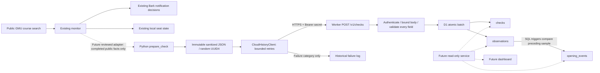

# Cloud persistence — Phase 3, Part 2A

This is an **offline-tested integration prototype**, isolated on
`phase3-cloud-persistence`. Nothing has been deployed or connected to a live
database. No Cloudflare account, production credential, paid service, GMU request,
or real notification is needed for development. Production `monitor.py`,
`health_runner.py`, `.github/workflows/seat-monitor.yml`, cron-job.org scheduling,
and Bark decisions are unchanged. No production entry point imports the client.
Setting environment variables alone does not connect the production monitor.

## Architecture



Solid ingestion components run only in explicit local tests today. The GMU/Bark
boxes describe the existing production system; tests replace those boundaries
with mocks. There is no ingestion-to-monitor, ingestion-to-GMU, or ingestion-to-Bark
path. Retries submit the same completed snapshot and cannot re-run a seat lookup.

Python's `sqlite3` opens local files; it **cannot connect directly to D1**. The
Python client speaks HTTP to a Worker. Cloudflare supplies the Worker's `DB`
binding to D1; no Cloudflare database API token belongs in the Python client or
request body. D1 is the eventual durable service across ephemeral Actions runs.

## Schema and migrations

`cloudflare/migrations/0001_history.sql` preserves the SQLite core tables,
column names, relationships, classifications, and indexes:

| Table | Keys and invariants |
| --- | --- |
| `checks` | Caller UUID4 `check_id` PK, UTC execution time, status, duration, nullable allowlisted error code, SHA-256 canonical request hash |
| `observations` | Integer `observation_id` PK, FK to check, public term/subject/course/section/CRN, nullable total/unreserved counts, sanitized reservation JSON, sample time, derived classification and potential count; unique `(check_id, term, crn)` |
| `opening_events` | Integer PK, unique FK to current observation, FK to previous observation, nonnegative previous count, strictly greater new count, detection time, event classification |

Indexes cover check time, `(term, crn, observed_at_utc DESC)`, and event time.
D1 foreign keys are active; referenced rows cannot be deleted independently.
Counts have integer/range checks, reservation JSON must be valid JSON, and status,
error, classification, and event-increase constraints apply in SQL. The API
additionally validates identity shapes, all metadata, and request size. All
application writes must use this API; administrative SQL can bypass some API
invariants and requires separate review.

The migration adds three triggers:

1. `check_retry` rejects reuse of a check ID with a different request hash.
2. `observation_order` rejects non-increasing sample times or changed
   subject/course/section for an existing term/CRN.
3. `detect_opening` inserts an event using the immediately preceding observation
   in the same transaction. No application read/compare/write race exists.

The Worker sends the check and up to 50 observations through **one `DB.batch()`**.
D1 batches commit together or roll back together. Opening-event triggers run
inside that transaction. Do not replace this with separate awaited writes or
with a read followed by a write. Python's `BEGIN IMMEDIATE`, connection PRAGMAs,
connection contexts, and `cursor.lastrowid` are not portable HTTP/D1 transaction
mechanisms. This prototype uses D1's batch semantics and SQL triggers instead.
Do not disable foreign keys or attempt SQL `BEGIN`/`COMMIT` through the Worker.

An exact retry updates the existing check hash to itself and skips all existing
observations. Reordered JSON/count keys and reordered course arrays normalize to
the same hash. Conflicting reuse is HTTP 409. Success, including an exact retry,
is HTTP 200 only after commit. A replay of an older **already committed** check
remains successful even after newer samples exist. A new backdated check is
rejected. Concurrent batches are serialized by D1's write transaction.

The initial migration targets an empty database. Wrangler tracks applied
migrations in its own table. Do not edit an applied migration: add a numbered
forward migration, test an upgrade from a prior schema and a restore, then
review separately. There is no automatic import of existing SQLite files.

### Compatibility adaptations

| Local Python SQLite | D1 prototype |
| --- | --- |
| Local file and `sqlite3` connection | Worker binding accessed through authenticated HTTP |
| Python serializes writers with `BEGIN IMMEDIATE` | One transactional D1 batch with database triggers |
| Caller-supplied general check ID | Canonical lowercase random UUID4 only; generate once per completed check |
| Arbitrary public reservation text (up to 2,000 characters) | Counts, null, or literal `"unknown"`; no free-form text crosses HTTP |
| Public uppercase error code | Fixed enum: `TIMEOUT`, `LOOKUP_TIMEOUT`, `COURSE_LOOKUP_FAILED`, `CHECK_FAILED` |
| Nonnegative finite duration | Maximum 86,400 seconds; at most 50 observations and 64 KiB |
| Python request hash format | Versioned Worker canonical hash; hashes are not interchangeable |
| Count dictionary with two unreserved keys | Both permitted only when their counts agree; avoids parser precedence ambiguity |

`prepare_check` reuses `CourseObservation.values()` and its Python parser, then
reduces parseable text to `{"unreservedAvailable": N}`. Missing or empty text
becomes null; unparseable text becomes the fixed `"unknown"` marker. Count-only
dictionaries retain their allowed fields. Free-form reserved labels and original
text are intentionally not retained. The JSON column remains compatible with the
historical model, but its normalized representation may differ from local files.

The Worker derives `unreserved_available`, `classification`, and
`potential_available` itself. The client cannot submit derived counts or events.
Its rules match SQLite: missing total is unknown/zero potential and breaks the
event chain; zero total is full; absent restrictions mean possible availability;
known unreserved is capped by total; explicit zero unreserved is reserved-only;
unparseable restrictions have zero potential. A first sample establishes a
baseline. Known subsequent increases produce `unreserved_increase` or
`possible_increase`. Reserved-only increases do not produce events. These are
sampled increases, not exact seat-opening times or proof of registration access.

All samples share the completed check's fixed-width microsecond UTC timestamp,
`YYYY-MM-DDTHH:MM:SS.ffffff+00:00`, matching SQLite sorting. Per-course sampling
times remain a future adaptation. Independent course/term baselines stay separate.

## API and authentication

Only `POST /v1/checks` exists. No SQL, query, read, dashboard, or notification API
is exposed. Query strings and unknown paths are rejected; other methods are
rejected. No browser CORS policy is enabled.

Requests require `Authorization: Bearer <secret>`, JSON content type, and a
securely configured Worker `INGEST_TOKEN` secret. Use at least 32 random bytes
encoded as unpadded base64url (43–128 allowed characters). Missing or malformed
server configuration fails closed with 503; absent/incorrect client credentials
receive 401 before body parsing or database access. Authentication compares
fixed-length SHA-256 digests without early return on differing bytes. Always
require HTTPS outside explicit loopback development. Rotate secrets out of band;
this prototype supports one current secret, not overlapping rotation windows.

```json
{
  "version": 1,
  "check_id": "8d5d8c1e-2765-4e45-a534-d45ef17a0d19",
  "executed_at_utc": "2026-11-09T00:00:00.000000+00:00",
  "duration_seconds": 0.25,
  "status": "success",
  "error_code": null,
  "observations": [{
    "term": "202710", "subject": "IT", "course_number": "304",
    "section": "DL1", "crn": "17582", "total_available": 1,
    "reserved_summary": {"unreservedAvailable": 1, "reservedAvailable": 0}
  }]
}
```

This example is synthetic. All keys shown are required; unknown keys are
rejected. Failed checks require an allowlisted error code and may contain zero
or more successful partial observations. Successful checks require at least one.
Counts are nullable where specified, otherwise integers from 0 to 1,000,000;
booleans, fractional numbers, and numeric strings are invalid seat counts. Reservation
dictionaries allow only `unreservedAvailable`, `unreservedRemaining`,
`reservedAvailable`, and `reservedRemaining` with bounded integer counts.
Term is six digits, subject is 1–10 uppercase letters, course number is 1–10
uppercase letters/digits, section additionally permits hyphens, CRN is 1–10
digits. UUIDs must be opaque random identifiers, never derived from identities.

The Worker bounds streamed body bytes even without Content-Length, rejects
invalid UTF-8/JSON and content encodings, caps observation count, checks genuine
calendar timestamps, rejects duplicate courses, and binds every SQL value.
Malformed data returns 400, oversized bodies 413, wrong media 415, order/identity/
idempotency conflicts 409, and unavailable storage 503. Error responses contain
fixed codes only, never SQL, exception text, credentials, or body contents.
Responses are `no-store`. Worker logs contain only fixed conflict/unavailable
categories. Do not enable request-body/header logging in surrounding infrastructure.

Only public course facts belong here. Student names/IDs, enrollment records,
faculty contacts, account details, raw API responses, secrets, and free-text
exceptions are excluded. A schema cannot establish the provenance of numeric
facts; the future caller must supply facts from approved public course fields.

## Python client and failure isolation

```python
from datetime import datetime, timezone
import uuid
from cloud_history import CloudHistoryClient, prepare_check, persist_best_effort
from seat_history import CourseObservation

# Synthetic data only. Production does not call this code.
prepared = prepare_check(
    str(uuid.uuid4()), datetime.now(timezone.utc), 0.25,
    [CourseObservation("202710", "IT", "304", "DL1", "17582", 1,
                       {"unreservedAvailable": 1})],
)
client = CloudHistoryClient.from_env()  # None unless explicitly enabled
try:
    result = persist_best_effort(client, prepared)
    print(result.success, result.code)  # No credentials or response body
finally:
    if client is not None:
        client.close()
```

Prepare once, retain the immutable `PreparedCheck.body`, and retry that snapshot.
Rebuilding with a new time, duration, or UUID is a new submission, not a retry.
The client revalidates the sanitized snapshot before sending, so manually
constructed or altered snapshots cannot add private or unrecognized fields.
The default client uses connect/read timeouts of 3.05/10 seconds, up to three
attempts and bounded exponential delays (0.25, 0.5 seconds). Limits are validated.
It retries timeouts, connection failures, invalid acknowledgements, and HTTP
408/429/500/502/503/504. Permanent errors and redirects are not followed/retried.
Only an exact, bounded `INGESTED` acknowledgement for the submitted ID is success.
Logs report a fixed category and attempt; exception messages and headers are
never printed. The default session disables ambient `.netrc` and proxy credentials;
environments requiring a proxy must explicitly provide a reviewed session.
Requests timeouts bound connection/read inactivity, not an absolute wall-clock
deadline; the future isolated process/step must also enforce its own total budget.

`persist_best_effort` contains unexpected client exceptions and returns a failure
result. Disabled returns `DISABLED`; it does not contact anything. A future adapter
must preserve the ordinary monitoring result and finish seat checks, state writes,
and Bark handling **before** historical recording. Prefer a separately bounded
step/process so ingestion latency cannot delay notifications. Do not combine the
ingestion exit status with the health runner's status, or notify Bark about
historical ingestion failures. Preparation errors also need that isolated boundary.
No production adapter is included or enabled in this phase.

## Environment variables and secrets

| Name | Location and purpose |
| --- | --- |
| `INGEST_TOKEN` | Worker secret binding; `.dev.vars` only for local synthetic development |
| `DB` | Worker D1 database binding, not a password or URL |
| `GMU_HISTORY_ENABLED` | Python `from_env()` returns a client only for literal `true` |
| `GMU_HISTORY_ENDPOINT` | Python HTTPS URL ending exactly in `/v1/checks`, no credentials/query/fragment |
| `GMU_HISTORY_TOKEN` | Python ingestion bearer secret, never a Cloudflare account API credential |
| `PYTHON` | Optional Python executable path used by Node's local parity test |
| `CLOUDFLARE_SEND_METRICS` | Set `false` for local Wrangler development |

No real values are included. `.dev.vars.example` contains a **public synthetic
local-only** token. `.dev.vars`, `.env`, local D1 state, SQLite files, and
`node_modules` are ignored. Future secrets belong in Cloudflare Worker secrets
and GitHub Actions secrets, entered by an authorized operator outside chat and
never committed. Never use the public synthetic token in any hosted environment.

## Local development and offline testing

Use Python 3.12 and Node 24. Install development dependencies from the lockfile;
installation requires package-registry access, while the tests require no live
services or Cloudflare credentials.

```bash
python -m venv .venv
.venv/bin/python -m pip install -r requirements.txt
.venv/bin/python -m unittest discover -s tests -v
.venv/bin/python -m compileall -q monitor.py setup_bark.py health_runner.py seat_history.py demo_history.py cloud_history.py tests cloudflare/test/parity.py
.venv/bin/python monitor.py --demo
.venv/bin/python demo_history.py
cd cloudflare
npm ci
npm test
```

The Node suite runs the actual Worker in Miniflare/workerd with an ephemeral
local D1 database, applies the SQL migration, and denies Worker outbound network.
It tests ingestion, auth, every input field, malformed/streamed oversized bodies,
deduplication, concurrent retries, reserved-only changes, ordering and identity
conflicts, real trigger-induced rollback, foreign keys, database unavailability,
and safe errors. A Python subprocess submits synthetic observations over loopback
to the Worker and compares derived rows/events with an independent temporary
`SeatHistory` database. It also retries every committed check and includes partial
and empty failures. Python tests mock HTTP to cover timeout/failure/acknowledgement
handling and assert real monitoring decisions remain isolated. No GMU/Bark/live
Cloudflare call is made. `npm test` disposes local D1 state when finished.

For optional interactive local-only development:

```bash
cd cloudflare
cp .dev.vars.example .dev.vars
CLOUDFLARE_SEND_METRICS=false npm run migrate:local
CLOUDFLARE_SEND_METRICS=false npm run dev
```

The configuration has a zero placeholder database ID, no account/routes, and
`workers_dev = false` / `preview_urls = false`. The scripts explicitly select
`--local` and bind only loopback. An explicit client constructor with
`allow_local_http=True` can address `http://127.0.0.1:8787/v1/checks` using the
synthetic local token; environment-based clients require HTTPS. Do not use remote
Wrangler flags, create a database, or run a deployment for this phase.

### Validation recorded for Part 2A

Local validation on the feature branch (Python 3.12.14, Node 24.22.1):

| Check | Result |
| --- | --- |
| Baseline at `origin/main` (`a3b52f3`) | All 69 existing Python tests passed before changes |
| Complete Python suite | 86 passed: 69 existing + 17 client/isolation tests |
| Local Worker/D1 suite | 14 passed, including real Python HTTP roundtrip and SQLite parity |
| Python compilation | All production/library/demo/test Python files passed |
| JavaScript syntax checks | Worker and Node tests passed |
| `monitor.py --demo` | Passed; full and reserved-only samples excluded, hypothetical unreserved opening recognized |
| `demo_history.py` | Passed; 4 checks, 6 observations, 1 unreserved event; temporary DB removed |
| `npm run migrate:local` | `0001_history.sql` applied successfully to local Wrangler D1 |
| Production diff guard | No change to `monitor.py`, `health_runner.py`, `seat_history.py`, or `seat-monitor.yml` |

Only the offline CI workflow adds new validation; the operational workflow is
unchanged. These results do not claim a live Cloudflare integration or recovery
test. No push, merge, deployment, production credential, real observation, or
notification was used.

## Recovery limitations and operations still needed

The immutable request is in memory, not a durable outbox. If ingestion fails
after all retries or the runner exits before acknowledgement, a sample may be
lost. Logs do not contain enough data to reconstruct observations. A timeout
after a server commit is safe to retry with the retained UUID/body; it does not
prove the server rolled back. There is no guarantee of exactly-once delivery,
only idempotent storage for a stable request.

New samples must arrive in time order for each term/CRN. A delayed older sample
will receive 409 after a newer sample commits. Future durable ordered outbox and
replay handling must be designed before enabling production. Concurrent distinct
checks may commit in a different order from collection and reject older samples.
Do not repair this by querying GMU again, changing the UUID, or sending alerts.
Administrative sorted imports/rebuilds need a separately reviewed tool.

D1 Time Travel/export/restore capabilities, recovery windows, quotas, retention,
and costs depend on the selected Cloudflare plan and have **not** been verified
against an account. Local Miniflare is not a production backup or proof of live
recovery behavior. Define an RPO/RTO, test backup/restore and replay in a separate
non-production database, protect exports, and account for deduplication history
being lost on restore or retention. Once old check IDs are deleted, the same
historical body may no longer deduplicate. No retention pruning is implemented.
Missed samples cannot reconstruct transient openings between checks.

## Future deployment requirements — not performed

1. Independent review of protocol, triggers, security, event parity, and isolation.
   Resolve ordered durable retry/replay handling and operational ownership.
2. An authorized operator must explicitly approve deployment, choose a suitable
   free allocation after checking quotas/costs, and create a separate staging D1
   database and Worker. No paid plan is assumed or introduced by this change.
3. Use a separate reviewed deployment configuration with the real DB binding and
   appropriate private/restricted route. Apply numbered migrations to staging;
   verify D1's actual transaction, concurrency, FK, and trigger behavior. Restrict
   account/API privileges to the necessary Worker and database resources.
4. Generate the ingestion secret outside source control. Store it using
   Cloudflare's Worker secret mechanism (future `wrangler secret put INGEST_TOKEN`)
   and the matching GitHub Actions secret. Do not put account credentials in the
   client. Verify TLS, log redaction, rotation/revocation, rate limiting, abuse
   controls, request budgets, and alerts through a non-Bark operational channel.
5. Test staging outage, timeout-after-commit, invalid auth, replay, quota exhaustion,
   migrations, recovery, and retention. Establish backups and a tested rollback
   plan. Disabling ingestion must not require altering normal checks or Bark.
6. Separately review a production adapter that consumes already completed public
   observations. Give it its own failure boundary and stable durable request
   snapshot; enable only after explicit authorization. Keep the normal check exit
   status and notifications independent. This prototype does not alter workflows
   to enable ingestion, deploy, add credentials, or change scheduling.

## Future dashboard integration

Add a separately authorized **read-only** service with fixed parameterized,
paginated queries over check health, course timelines, and sampled openings.
Never give the browser the ingestion secret, a D1/account token, or arbitrary SQL.
Use separate authentication/access controls and deliberate caching/retention.
Preserve unknown/reserved-only/possible labels, UTC/sample time, gaps in coverage,
and uncertainty about eligibility and exact opening times. Aggregate by detection
date with exposure counts, following `SeatHistory.openings_by_day()`. No dashboard
or read endpoint is implemented in Part 2A.
