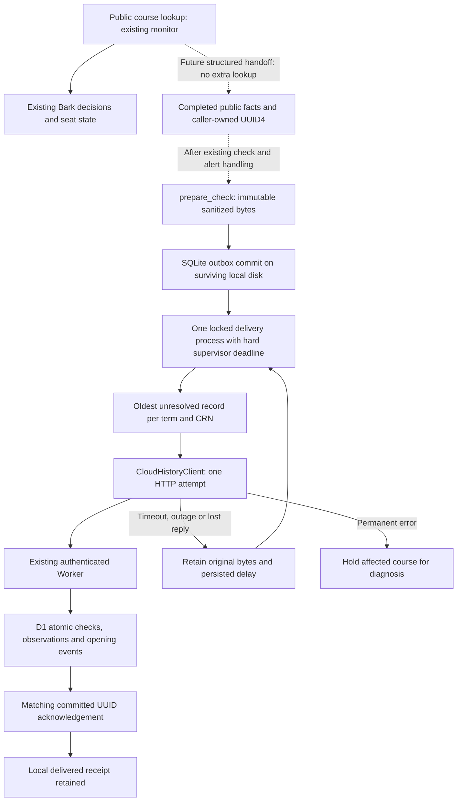

# Historical capture and ordered retries

This milestone implements **offline reliability components**, on
`reliability/ordered-history-outbox`, based on main commit `47fd95b`. It does not
connect production monitoring. The operator reports that authenticated staging
Worker/D1 ingestion and point-in-time recovery have already been verified; this
work does not contact that deployment or independently repeat those remote tests.

## Architecture review and decision

| Existing component | Finding and consequence |
| --- | --- |
| `monitor.py` | Owns public lookups, seat decisions, Bark and the latest JSON snapshot. Keep all behavior unchanged. A future producer must copy completed, structured public observations from the original lookup, without fetching again. |
| `health_runner.py` | Runs the monitor in a subprocess, with a 240-second timeout, and parses display output for health. Display text lacks complete structured facts, precise sample times and UUIDs; it is not a history interchange format. A timeout can preserve partial logs without preserving observations. |
| `seat_history.py` | Local SQLite history is transactional and append-only per term/CRN. It rejects backdated observations. It is an analytics destination, not an HTTP retry queue. |
| `cloud_history.py` | Already sanitizes public facts, prepares canonical immutable bytes/UUID4, bounds HTTP attempts and validates acknowledgements. Previously all retry state was in memory. |
| Worker | Authenticates, validates, hashes canonical input and commits one D1 batch. Acknowledgement follows commit; timeout does not imply rollback. Exact older retries remain valid even after newer samples. |
| `0001_history.sql` | Idempotency/order/identity triggers roll back conflicts atomically; opening events use the preceding sample. Late *new* records cannot be safely inserted without recomputing successors. Keep this schema unchanged. |
| `seat-monitor.yml` | Ephemeral Linux runner, best-effort snapshot cache, existing monitor/Bark path. Concurrency reduces overlapping executions but provides neither durable history nor recovery of lost runs. No workflow or five-minute external schedule change. |
| `ci.yml` | Offline-only Python and local Miniflare/D1 tests; extend these, without deployment steps or live credentials. |

**Selected approach:** a disk-backed SQLite outbox plus a single, separately
bounded delivery process, reusing the existing authenticated Worker and D1 as the
destination. This needs no new Python dependency, queue subscription, migration
or Worker route. `history_outbox.py` is implemented and independently testable.
No production adapter, process supervisor or persistent host is provisioned.

The outbox is durable **only when its local filesystem survives**. A fresh file
on each GitHub-hosted runner cannot provide cross-run recovery. Caches can be
evicted, artifacts can expire or never upload, and cancellation can skip cleanup
steps. Neither is a permanent write-ahead log. Merely adding this module to an
Actions step would still provide best-effort delivery.

For durable capture through Cloudflare outages, the producer needs a surviving
disk outside the disposable runner (for example, an already-owned Linux host and
persistent volume). There is no evidence such a resource currently exists.
Reusing an existing machine can avoid a paid service; no free hosted disk or
availability guarantee is assumed. Without that resource and a reviewed producer
handoff, production must stay disconnected. This is the intentionally unfinished
infrastructure boundary allowed by this milestone.

An alternative future durable inbox in the existing Worker/D1 could acknowledge
accepted pending bodies before projection into the history tables. That would
require an inbox schema, durable producer order/watermarks, an authenticated
capture route, a scheduled drain, replay tooling and separate review. It still
cannot preserve an observation that never reaches Cloudflare before its ephemeral
runner disappears during a Cloudflare outage. A second independent durable source
would be needed for that stronger guarantee. Cloudflare Queues/KV, Git commits,
Actions concurrency or a D1 history table alone do not solve this capture gap or
the ordering of unseen records. None is added here.



Dashed links are **not implemented or enabled**. Solid new components are exercised
only with synthetic inputs. There is no historical retry path to GMU or Bark.

## Contract and ordering

1. A future producer assigns one random UUID4 and a UTC timestamp to a completed
   check, retaining that identity for the entire handoff. Do not reconstruct a
   retry from logs, `seat_state.json`, a new lookup, a new UUID, or the current
   time. The state cache can contain observations from different or failed runs.
2. `prepare_check` validates and sanitizes only completed public course facts.
   Counts are whitelisted; arbitrary reserved-seat text becomes counts or the
   fixed `unknown` marker. A partial failed check may include successful course
   observations. Never invent an observation for a failed lookup.
3. `enqueue` revalidates canonical bytes and commits them, their SHA-256 and
   course keys together. Exact re-enqueue is a no-op, including after delivery;
   reusing a UUID for changed bytes fails. `ENQUEUED` means **local commit**, not
   D1 acceptance. Preparation/storage errors have a separate best-effort boundary
   (`enqueue_completed_best_effort`); its result cannot replace monitor health.
4. Pending records are sorted by observation UTC timestamp. Before any attempt,
   older pending input can be inserted and will run first. Distinct records with
   identical timestamps for the same course are rejected as ambiguous. Equal
   timestamps for different courses are allowed. Current protocol batches share
   one timestamp; it is a completed-check sample time, not exact opening time.
5. The earliest unresolved check blocks all later checks sharing any term/CRN.
   This includes deferred and permanently blocked records, and dependencies
   propagate through multi-course batches. Independent courses can progress;
   the current two-course batches will normally block both courses together.
6. An OS `flock` serializes enqueue and drain across processes. It is held through
   HTTP; there is no expiring lease that could permit a slow old sender to commit
   after a new owner. Contention fails immediately with `OUTBOX_BUSY`. Only the
   historical producer must retain/retry the handoff; monitoring must not wait
   for that lock. No unsupported NFS/object-sync/shared-disk locking is assumed.
7. An attempt counter, time frontier and next retry time commit **before HTTP**.
   An unacknowledged attempt may already exist remotely. A new backdated record
   at/below that course's attempted frontier is rejected (`OUTBOX_LATE_RECORD`).
   The original UUID/body remains retryable. Unknown future/missing observations
   cannot be ordered by this queue: late data fails closed instead of silently
   changing opening events. All writers must use this one queue authority.
8. Only a matching `INGESTED` acknowledgement permits a delivered receipt. Receipt
   failure or process death leaves the original pending; retry may acknowledge
   an already committed D1 transaction without another observation or event.
   Check IDs, payloads and delivered receipts are retained; no pruning is added.

`validate_prepared` is now a public shared boundary, used before local storage and
network transmission. The HTTP client distinguishes retryable HTTP failures from
permanent failures so a 503 is retained for automatic retry while a 404 is held.

## Expected failures

| Failure | Historical behavior | Existing monitoring/Bark |
| --- | --- | --- |
| Timeout, connection failure, HTTP 408/429/5xx (including Cloudflare edge errors), invalid acknowledgement | Keep body pending; delay 60, 120, 240… seconds capped at 3,600, persisted across restarts; no later same-course submission | Unchanged; history is separate |
| HTTP 400/401/409/413 or another permanent HTTP failure | Keep and block affected course(s); operator diagnoses before `retry` | No history-generated phone alert |
| Unexpected client exception | Fixed `CLIENT_ERROR`; keep pending with backoff; no exception text logged | No change to check outcome |
| Death before outbox commit | Transaction rolls back; producer must still hold original facts, otherwise sample is lost | Existing semantics remain |
| Death after attempt commit, during HTTP, or after remote commit but before receipt | OS releases lock; original pending body/delay survive; restart retries idempotently | No new lookup or Bark retry |
| Slow streaming response | Inactivity timeouts alone are insufficient; supervisor kills bounded historical process; queue remains pending | Must not share monitoring's process/time budget |
| Outbox unavailable, full, locked, corrupt, or on unsupported platform | Capture returns a fixed failure; no silent queue recreation or dropping oldest rows; investigate and recover from surviving source | Best-effort boundary preserves monitor result |
| Missed scheduler run or no successful public lookup | No observations exist to replay | Cannot recover a transient opening retrospectively |
| Late older data after later attempt | Reject locally, or hold on remote 409 if another writer had advanced D1 | No invented/reordered events |
| Bark rejects a push | Does not suppress an independently supplied completed observation | Existing monitor handles the push exactly as before |

One drain invocation attempts at most `--limit` records (default 20), with one
HTTP attempt per record. Backoff never sleeps inside the queue. HTTP retries
never repeat a public course lookup. `drain` exits nonzero if pending/blocked
records remain; operational code must report that separately from seat health.
Wall-clock retry timing assumes a reasonably synchronized host clock; clock
rollback can delay recovery, without permitting same-course overtaking.

## Resources and setup still required — not performed

Before considering production activation, provide and review:

- One Linux/POSIX queue owner with a local persistent filesystem, SQLite locking
  and honest fsync semantics. Use a dedicated owner-only directory, one canonical
  database path, no hard-linked aliases, and the same file for every producer and
  consumer. Do not copy a live outbox between runners or run independent clones.
- A producer handoff from the **original completed structured observations**.
  Monitoring, state writes and Bark must finish on their existing path first.
  The historical handoff must retain original UUID/body on contention/failure
  until durable acknowledgement, without holding up subsequent course checks.
  An ephemeral-to-host handoff alone still has a loss window before acceptance.
  Preserving facts across that window requires durable source capture as well.
- A separate supervised consumer, restarted periodically with a hard total
  deadline (for example GNU `timeout --signal=TERM --kill-after=5s 60s ...`).
  Python timeouts are connect/read inactivity limits, not that deadline. A killed
  process may leave an in-flight remote commit, which the retry protocol covers.
- Existing Worker/D1 endpoint access and a scoped ingestion secret, entered
  outside source/chat. Do not grant the history process Bark credentials or GMU
  credentials. No real values are needed for local tests. There are no new cloud
  resources or migrations to apply for the selected disk-backed design.
- Disk/pending-age/blocked-record checks, backups of the outbox and D1, and a
  tested restore procedure on a separate non-production target. Operational
  signals must not reuse Bark seat-opening notifications.

The external five-minute schedule, monitoring authorization settings and live
workflow are outside this change. Scheduling a delivery process is future
operational work and is not activated here.

## Local use and recovery

All examples use a new local directory; **do not run them against staging**.
`init`, `enqueue`, `status` and `retry` perform no network operations. `drain`
requires explicit client configuration; an unset `GMU_HISTORY_ENABLED` returns
`DISABLED` without attempting a submission. Only tests use loopback HTTP.

```bash
mkdir -m 700 /tmp/gmu-history-example
python history_outbox.py --db /tmp/gmu-history-example/outbox.sqlite3 init
python history_outbox.py --db /tmp/gmu-history-example/outbox.sqlite3 status
```

Use the library with synthetic completed facts:

```python
from datetime import datetime, timezone
from pathlib import Path
import uuid
from cloud_history import prepare_check
from history_outbox import HistoryOutbox
from seat_history import CourseObservation

box = HistoryOutbox('/tmp/gmu-history-example/outbox.sqlite3')
prepared = prepare_check(str(uuid.uuid4()), datetime.now(timezone.utc), 0.25,
    [CourseObservation('202710', 'IT', '304', 'DL1', '17582', 0)])
box.enqueue(prepared)  # Persist once; retry from this queue, not a new prepare call.
# Optional local interchange: exact canonical bytes, no trailing newline.
Path('/tmp/gmu-history-example/prepared.json').write_bytes(prepared.body)
```

1. **Routine outage or interrupted drain:** keep the same file and `.lock` path;
   restart the bounded consumer when the endpoint recovers. `status` reports
   pending IDs, attempts, next-attempt Unix times, blocked flags and fixed codes,
   without payload bodies. A live lock must never be deleted. If a process is
   hung, terminate it using the supervisor; OS lock release enables safe restart.
2. **Permanent failure:** inspect the fixed code and configuration, without
   logging secrets. Correct auth/endpoint problems out of band. For a 409,
   distinguish changed UUID contents, changed course identity, and backdated
   input using retained public bodies and reviewed database inspection. After
   diagnosis, `python history_outbox.py --db PATH retry CHECK_UUID` clears the
   local hold/delay; it does not alter bytes, UUID, timestamp or course ordering.
   Repeating a conflict without fixing its cause will block it again. No skip,
   drop or payload-edit command exists.
3. **Local corruption or disk loss:** stop historical producers/consumer, preserve
   files/journals and restore the outbox backup. Do not `init` a missing production
   file to hide the loss. SQLite backup API is preferred for snapshots; coordinate
   backups/restores with the sole queue owner and run `PRAGMA integrity_check` on
   the backup. Never copy just a live main file while excluding its journal.
   Retrying a stale backup is safe for retained IDs; samples absent from both
   backup and destination are unrecoverable without another surviving source.
4. **D1 point-in-time restore:** delivered receipts may now overstate remote
   contents. Keep the original outbox as an archive. Build a **new local replay
   outbox** from all retained original bodies, including delivered ones, ordered
   by timestamp. Re-enqueueing into the original queue is deliberately a no-op.
   After separate operator review, drain the replay queue into the restored
   target. Retained D1 IDs deduplicate; a missing suffix appends in order. Verify
   row/event counts and pending/blocked state on a separate test target first.
5. **Older missing records behind a remote watermark:** do not rewrite timestamps
   or generate new UUIDs. The existing API cannot backfill those records. Preserve
   the archive and review a rebuild into a fresh database from the complete sorted
   source; only then consider a cutover. Missing source records cannot be invented.

For step 4, while the original owner is stopped, this local-only script creates
the replay file without changing source data (use the Python environment with
project dependencies). No submission occurs:

```python
from pathlib import Path
import sqlite3
from cloud_history import PreparedCheck
from history_outbox import HistoryOutbox

source = Path('/path/to/retained-outbox.sqlite3').resolve()
replay_path = Path('/path/to/new-replay.sqlite3')
assert not replay_path.exists()  # Deliberate new queue, never overwrite the archive.
replay = HistoryOutbox(replay_path)
replay.initialize()
with sqlite3.connect(source.as_uri() + '?mode=ro', uri=True) as db:
    for check_id, body in db.execute('SELECT check_id, body FROM submissions ORDER BY stamp, check_id'):
        replay.enqueue(PreparedCheck(check_id, body))
```

## Quotas, retention and realistic guarantees

At two courses every five minutes: 288 completed checks and up to 576 observations
per day. A batched normal drain makes about 288 Worker requests/day, plus retries;
an outage does not cause each newer same-course record to be attempted repeatedly.
The base D1 inserts are about 864 rows/day plus opening events, index maintenance,
check upsert writes and retries. D1 bills/counts affected/indexed rows, not merely
HTTP requests; measure actual writes and query scans before enabling anything.

Common published free-tier planning ceilings are 100,000 Worker requests/day,
5 million D1 rows read/day, 100,000 rows written/day and 5 GB total D1 storage.
These are planning assumptions, **not account-verified entitlements**. Verify
[D1 limits](https://developers.cloudflare.com/d1/platform/limits/),
[D1 pricing](https://developers.cloudflare.com/d1/platform/pricing/) and
[Workers limits](https://developers.cloudflare.com/workers/platform/limits/)
for the actual plan before activation. Limit backfill volume, share budgets with
other workloads and stop on quota/storage failure. Public/private Actions quotas
are separate; no extra monitoring run, polling or schedule is introduced here.

Storage grows indefinitely: at this rate roughly 105,120 checks and 210,240
observations per year, plus payloads, receipts, events and indexes. Disk/D1 size
must be measured; no storage lifespan is promised. This version intentionally
does not prune deduplication bodies or attempted frontiers. A retention policy
must preserve those invariants and a source archive before deletion is added.
Disk exhaustion can lose *new capture*, even while existing queued rows survive.

The guarantee is at-least-once retry of locally committed bodies **while that
source survives**, with idempotent D1 effects for retained UUIDs. It is not
exactly-once delivery or end-to-end lossless monitoring. Data can still be lost
before enqueue, when ephemeral runners disappear, when the only disk fails,
when backups omit samples, or when operators delete deduplication/source history.
Future source-to-outbox integration will also have a handoff window. RPO for disk
failure is the last surviving backup; RTO depends on the outage, backlog and rate
budget. D1 Time Travel does not back up observations D1 never received. No sampling
system can reconstruct openings that appeared and vanished between lookups.

## Offline validation

```bash
.venv/bin/python -m unittest discover -s tests -v
CLOUDFLARE_SEND_METRICS=false npm test --prefix cloudflare
```

The added Python tests cover local commits, retry/backoff recovery, byte identity,
out-of-order pending input, duplicate/conflicting IDs, tied/late timestamps,
multi-course blocking, independent-course progress, Cloudflare HTTP outages,
abrupt process death, supervisor termination, lock contention, corruption,
partial checks, preparation/storage failures and monitoring/Bark isolation.
The added Miniflare test commits an older record through the real Python client,
terminates that producer before saving its receipt, restarts it on the same disk,
and verifies retry-before-newer delivery yields two observations and one event.
It then removes a local D1 suffix to simulate a restore and validates replay from
the retained bodies into a new outbox, without changing the original archive.
All payloads are synthetic; Worker outbound access is denied. No GMU, Bark, remote
Cloudflare, secrets, deployment, database alteration, push or merge is involved.

This implementation is ready for independent review of the offline components.
Production activation requires the durable resource/handoff decisions above.

Validation recorded locally with Python 3.12.14 and Node 24.22.1:

| Check | Result |
| --- | --- |
| Complete Python suite | 107 passed (86 existing, 21 added) |
| Local Worker/D1 suite | 15 passed (14 existing, 1 added crash/restart/restore scenario) |
| Python compilation and JavaScript syntax checks | Passed |
| Both offline demos | Passed |
| Diff/whitespace check | Passed |
| Production guard | Monitor, health runner, seat history, operational workflow, Worker, D1 migration/configuration and dependencies unchanged |
