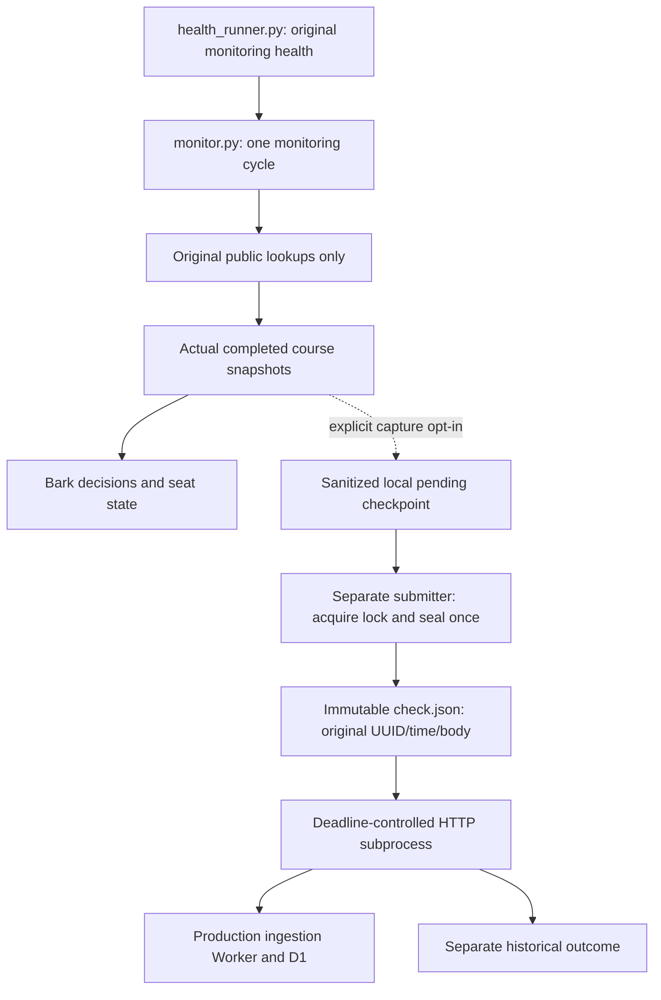

# Structured observation handoff

The deployed workflow copies completed public observations into a local per-run handoff and submits them in a separate bounded process. `health_runner.py` supervises the ordinary monitor; historical facts come directly from successful lookup results, not health-log parsing or cached state. Capture and submission each require an explicit opt-in and default off when unset.

The Actions disk is temporary. This protocol preserves original facts while that disk survives; it is not a cross-run durable archive. The [D1 design](CLOUDFLARE_DURABLE_HISTORY.md) describes destination durability and [operations](../CLOUD_SETUP.md) owns repository configuration.

## Configured section identity

Each successful lookup carries the exact configured section and CRN. The [target table](../README.md#section-identity-and-lifecycle) contains multiple sections of one course; history preserves them independently using `(term, crn)`. Retirement does not invalidate delayed historical facts or existing retry bodies.

## Architecture and invariants

- One `CheckCapture` is created at the beginning of each original monitor cycle,
  before term discovery. It owns exactly one random UUID4 and one UTC sample
  timestamp. This timestamp represents **cycle start**, not the precise instant
  a seat opened or any lookup completed. All course observations share
  it, matching the existing check-level API. Duration uses a monotonic clock.
- `check_once(..., capture=None)` copies each successfully returned snapshot
  directly into the opt-in producer, after that course's Bark decision and
  seat-state persistence, before the existing two-second sleep. No
  requests are added. It never invents a result when `get_section` fails.
- All successful active lookups form one successful check. Any lookup failure makes the check failed while retaining the other successful observations. Complete lookup failure or term-discovery failure yields zero observations. Missing courses are never filled from cached state or treated as full.
- History initialization, sanitization, checkpoint and finalization exceptions
  are isolated. They print only `CAPTURE_PREPARATION_FAILED`, never the exception
  text, and do not alter seat decisions, state saves, monitor return values, or
  health reporting. One preparation failure does not poison the other course.
- The producer imports no HTTP submission code directly and never submits a
  check. The existing `CourseObservation` validator and `prepare_check` canonical
  encoder are reused through the capture library; importing them performs no I/O.

## Local protocol and interruptions

A configured per-run directory contains one UUID-named subdirectory per cycle:

| File | Meaning |
| --- | --- |
| `owner.lock` | Exclusive POSIX lock held for the entire producer cycle or submission attempt; never unlink a live lock |
| `pending.json` | Canonical, validated, sanitized checkpoint; **never sent** |
| `check.json` | Once-sealed original request bytes; **never rewritten** |
| `receipt.sha256` | Matching commit acknowledgement recorded locally; digest of endpoint plus immutable body, with no token or URL |

Each successful lookup replaces the checkpoint atomically using a flushed,
fsynced temporary file. Until normal finalization its check status is `failed`,
with fixed `CHECK_FAILED`. Finalization publishes the normal status and duration;
lookup failures use `COURSE_LOOKUP_FAILED`, and a preparation error uses
`CHECK_FAILED`. No HTTP can see an active producer's changing checkpoint: the
consumer must obtain its lock nonblockingly before renaming `pending.json` to
`check.json`. It validates the body and UUID-directory agreement before sealing
and again before sending. The body is never reconstructed for a retry.

On graceful interruption the lock closes without rewriting the checkpoint. On
process kill, the OS releases it. A subsequent separately invoked submission can
seal the surviving checkpoint with its **existing** UUID, timestamp, duration,
failed status and completed observations. It does not fabricate a final duration
or assume missing courses succeeded. A death before a checkpoint publishes can
lose that observation. In particular, interruption during Bark delivery, state
persistence, or the interval before checkpoint publication can now leave a
successful lookup absent from history even though its alert/state work may have
completed. Earlier published course observations remain available in the failed
checkpoint; missing courses are never backfilled from state. This wider crash
window keeps synchronous history filesystem work off the current course's alert
and state-save path. Slow capture can still delay the next course or cycle.

Submission starts a separate HTTP worker and imposes a total **20-second default
wall-clock deadline**, configurable only within `(0, 45]` seconds. It covers
imports, filesystem work, DNS, connection, response reads, retries and backoff.
The supervisor kills/reaps the child at the deadline or on SIGTERM/SIGINT; the
worker also has an independent POSIX timer if its supervisor is killed. Per
check, the existing client makes at most three attempts, with bounded backoff and
2/4-second connection/read timeouts. Read timeouts alone would not bound a
trickled acknowledgement, hence process-level enforcement. A handoff invocation
accepts at most 50 check directories and stops on the first unsuccessful check.
These limits reset on a later explicit retry, always using sealed bytes.

A matching `INGESTED` acknowledgement for the original UUID confirms a D1 commit.
A missing local receipt causes an identical retry; D1 deduplicates it. Receipts
are scoped to the destination, so switching endpoints cannot falsely skip a
check acknowledged by another target. Retrying historical submission **never**
launches `monitor.py`, calls `get_section`, or invokes Bark. Rerunning the whole
Actions monitoring job creates a **new original check**, not a delivery retry.

SIGKILL, machine failure and Actions cancellation may prevent cleanup, local
receipts and even the final report. The worker timer limits an orphan's remaining
work where the process survives; no code can guarantee a report after runner
termination. Cancellation skips the workflow's submission step. Monitoring state
validation/cache save precedes history and retains its existing `always()` rules.
The unchanged five-minute job timeout includes installation, monitoring, cache
work and historical submission, so the latter may never start if time runs out.

## Separate outcomes and privacy

`history_submit.py` writes fixed codes/counts to its console, optional JSON report,
and a separate Actions summary section. It never changes `run_health.json` or
its success field. Its process exit is nonzero for failed/unconfirmed delivery;
the workflow step uses `continue-on-error: true` so this cannot replace monitoring
health. Use the historical summary/step outcome to investigate independently.

| Historical outcome | Interpretation |
| --- | --- |
| `disabled / DISABLED` | No worker, capture read or HTTP request |
| `success / INGESTED` | All checks in this invocation have matching commit acknowledgements or matching local receipts |
| `failed / CONFIGURATION_ERROR`, `CAPTURE_INVALID`, `CAPTURE_BUSY`, `NO_CAPTURES` | Local preparation/configuration/availability problem; no success claim |
| `unconfirmed / TIMEOUT`, `DEADLINE`, `INTERRUPTED`, HTTP/client/acknowledgement codes | One or more checks may already have committed; retain original bytes for retry if they survive |

An ingested **failed check** is historical submission success, not monitoring
success or proof of complete capture. `CHECK_FAILED` can indicate interruption
or preparation failure; the capture log reports the latter separately. On a
process deadline, reported counts may be zero even if the child committed checks
before it was killed. They are not proof that D1 is empty. Even an explicit HTTP
rejection is conservatively unconfirmed, since an earlier retry may have lost an
acknowledgement. Bark delivery remains unverified by monitoring health.

The handoff allows only UUID/time/duration/status/fixed error code and public
term, subject, course number, section, CRN, total availability and a sanitized
unreserved count/`unknown` marker. Totals outside the allowed integer range become
unknown, never zero. Reservation text, unrelated dictionaries, course titles,
student/faculty fields, original API bodies and arbitrary errors do not enter
historical files. Files are owner-only; generated default paths are gitignored.
Custom capture paths must also stay outside tracked files. No artifacts are
uploaded and no history files are included in the alert-state cache.

Only the submission step receives the production ingestion token; it stays in
process memory/environment, never in arguments, request bodies, files, logs or
artifacts. No Cloudflare management credential is needed. The HTTP client refuses
redirects, URL credentials/query strings, non-HTTPS endpoints and ambient
`.netrc`/cookie/proxy authentication. `--allow-local-http` is explicitly restricted
to loopback for offline testing. Raw response bodies and exceptions are discarded.
These rules describe the historical path; existing monitor seat snapshots,
Bark messages and health logs retain their existing behavior.

**Delivery is not lossless.** The Actions disk is temporary, not a persistent
outbox. Cloudflare outages can exhaust the bounded attempts. When that runner
disappears, unsent or unconfirmed original bodies may disappear too. D1 retains
committed facts, but cannot recover a sample it never received. The optional
SQLite outbox needs surviving POSIX storage and is not used here. Accept this
loss window explicitly or design a separately authorized durable capture source
when evaluating stronger capture guarantees. Caches and artifacts are not durable queues.

## Configuration and operational control

The capture and submission gates require literal lowercase `true`; unset defaults are off. Configuration names and secret scopes are listed in [operations](../CLOUD_SETUP.md#configuration-boundaries).

The submitter uses only `GMU_HISTORY_PRODUCTION_ENDPOINT` and `GMU_HISTORY_PRODUCTION_TOKEN`. It ignores the generic client's staging/local environment names and never falls back to a synthetic destination. The per-run capture path is generated under `runner.temp` and history bytes are not placed in the alert-state cache or uploaded as artifacts.

To pause delivery, disable `GMU_HISTORY_ENABLED`; capture can be disabled independently. Preserve surviving sealed bodies for exact replay. Do not regenerate UUIDs or rerun monitoring to repair history. Endpoint/secret changes require checking destination identity and receipt scope. A missing local receipt after a remote commit causes a safe identical retry, not proof of missing data.

## Offline verification

Use the [local validation commands](LOCAL_DEMO.md) for the complete Linux/POSIX suite.

Tests cover multi-section success, legacy partial-failure orders, complete/term failure,
identical alert/state/health behavior, isolated preparation/storage failures,
explicit default-off gates, sanitization, no extra GMU/Bark requests, local HTTP
errors, lost acknowledgements/receipts with identical bytes, unexpected client
exceptions after a possible commit, the actual default 20-second deadline under
a continuously trickling reply, producer kill and submitter interruption. Worker tests include
the real handoff -> HTTP subprocess -> disposable Miniflare D1 path with a lost
receipt retry. All facts/tokens are synthetic; no production secrets are required.
