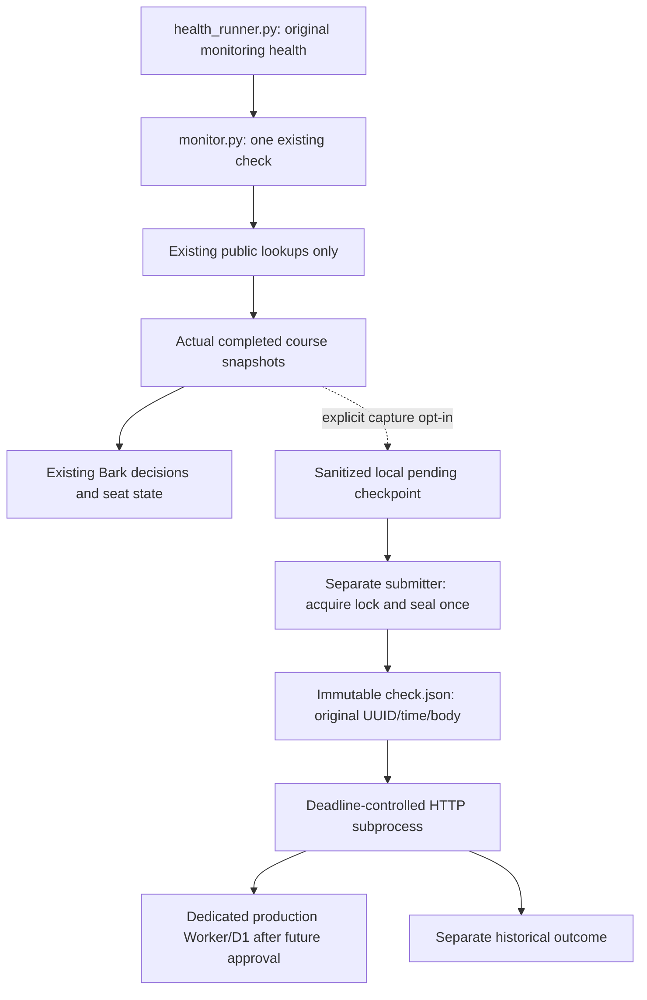

# Opt-in live observation handoff (disabled)

This milestone adds a structured producer and separate historical submission
adapter. **Nothing is activated by this change.** Ordinary monitoring remains
`health_runner.py` -> `monitor.py --once`, with the existing Bark decisions,
`seat_state.json` cache, polling approval and approximately five-minute external
schedule. Health reporting still uses its existing output parser; historical
observations never use that parser or the state cache.

The operator reports that migration **0002** and its matching Worker have been
deployed and tested in **synthetic staging**. No remote verification is performed
here. That staging database and the recovery-test database are not production
history stores. This branch does not deploy, change them, set secrets, or contact
GMU/Bark. `cloudflare/wrangler.toml` remains a local-only configuration.

## Architecture and invariants



- One `CheckCapture` is created at the beginning of each original monitor cycle,
  before term discovery. It owns exactly one random UUID4 and one UTC sample
  timestamp. This timestamp represents **cycle start**, not the precise instant
  either seat opened or either lookup completed. Both course observations share
  it, matching the existing check-level API. Duration uses a monotonic clock.
- `check_once(..., capture=None)` copies each successfully returned snapshot
  directly into the opt-in producer, after that course's Bark decision and
  seat-state persistence, before the existing two-second sleep. No
  requests are added. It never invents a result when `get_section` fails.
- Both successful courses form one successful check. One failed lookup yields a
  failed check with only the other course's successful observation. Two failures
  or term-discovery failure yield a failed check with **zero** observations.
  Failed/missing courses are never filled from cached state or treated as full.
- History initialization, sanitization, checkpoint and finalization exceptions
  are isolated. They print only `CAPTURE_PREPARATION_FAILED`, never the exception
  text, and do not alter seat decisions, state saves, monitor return values, or
  health reporting. One preparation failure does not poison the other course.
- The producer imports no HTTP submission code directly and never submits a
  check. The existing `CourseObservation` validator and `prepare_check` canonical
  encoder are reused through the capture library; importing them performs no I/O.

## Local protocol and interruptions

A configured per-run directory contains one UUID-named subdirectory per cycle:

| File | Meaning |
| --- | --- |
| `owner.lock` | Exclusive POSIX lock held for the entire producer cycle or submission attempt; never unlink a live lock |
| `pending.json` | Canonical, validated, sanitized checkpoint; **never sent** |
| `check.json` | Once-sealed original request bytes; **never rewritten** |
| `receipt.sha256` | Matching commit acknowledgement recorded locally; digest of endpoint plus immutable body, with no token or URL |

Each successful lookup replaces the checkpoint atomically using a flushed,
fsynced temporary file. Until normal finalization its check status is `failed`,
with fixed `CHECK_FAILED`. Finalization publishes the normal status and duration;
lookup failures use `COURSE_LOOKUP_FAILED`, and a preparation error uses
`CHECK_FAILED`. No HTTP can see an active producer's changing checkpoint: the
consumer must obtain its lock nonblockingly before renaming `pending.json` to
`check.json`. It validates the body and UUID-directory agreement before sealing
and again before sending. The body is never reconstructed for a retry.

On graceful interruption the lock closes without rewriting the checkpoint. On
process kill, the OS releases it. A subsequent separately invoked submission can
seal the surviving checkpoint with its **existing** UUID, timestamp, duration,
failed status and completed observations. It does not fabricate a final duration
or assume missing courses succeeded. A death before a checkpoint publishes can
lose that observation. In particular, interruption during Bark delivery, state
persistence, or the interval before checkpoint publication can now leave a
successful lookup absent from history even though its alert/state work may have
completed. Earlier published course observations remain available in the failed
checkpoint; missing courses are never backfilled from state. This wider crash
window keeps synchronous history filesystem work off the current course's alert
and state-save path. Slow capture can still delay the next course or cycle.

Submission starts a separate HTTP worker and imposes a total **20-second default
wall-clock deadline**, configurable only within `(0, 45]` seconds. It covers
imports, filesystem work, DNS, connection, response reads, retries and backoff.
The supervisor kills/reaps the child at the deadline or on SIGTERM/SIGINT; the
worker also has an independent POSIX timer if its supervisor is killed. Per
check, the existing client makes at most three attempts, with bounded backoff and
2/4-second connection/read timeouts. Read timeouts alone would not bound a
trickled acknowledgement, hence process-level enforcement. A handoff invocation
accepts at most 50 check directories and stops on the first unsuccessful check.
These limits reset on a later explicit retry, always using sealed bytes.

A matching `INGESTED` acknowledgement for the original UUID confirms a D1 commit.
A missing local receipt causes an identical retry; D1 deduplicates it. Receipts
are scoped to the destination, so switching endpoints cannot falsely skip a
check acknowledged by another target. Retrying historical submission **never**
launches `monitor.py`, calls `get_section`, or invokes Bark. Rerunning the whole
Actions monitoring job creates a **new original check**, not a delivery retry.

SIGKILL, machine failure and Actions cancellation may prevent cleanup, local
receipts and even the final report. The worker timer limits an orphan's remaining
work where the process survives; no code can guarantee a report after runner
termination. Cancellation skips the workflow's submission step. Monitoring state
validation/cache save precedes history and retains its existing `always()` rules.
The unchanged five-minute job timeout includes installation, monitoring, cache
work and historical submission, so the latter may never start if time runs out.

## Separate outcomes and privacy

`history_submit.py` writes fixed codes/counts to its console, optional JSON report,
and a separate Actions summary section. It never changes `run_health.json` or
its success field. Its process exit is nonzero for failed/unconfirmed delivery;
the workflow step uses `continue-on-error: true` so this cannot replace monitoring
health. Use the historical summary/step outcome to investigate independently.

| Historical outcome | Interpretation |
| --- | --- |
| `disabled / DISABLED` | No worker, capture read or HTTP request |
| `success / INGESTED` | All checks in this invocation have matching commit acknowledgements or matching local receipts |
| `failed / CONFIGURATION_ERROR`, `CAPTURE_INVALID`, `CAPTURE_BUSY`, `NO_CAPTURES` | Local preparation/configuration/availability problem; no success claim |
| `unconfirmed / TIMEOUT`, `DEADLINE`, `INTERRUPTED`, HTTP/client/acknowledgement codes | One or more checks may already have committed; retain original bytes for retry if they survive |

An ingested **failed check** is historical submission success, not monitoring
success or proof of complete capture. `CHECK_FAILED` can indicate interruption
or preparation failure; the capture log reports the latter separately. On a
process deadline, reported counts may be zero even if the child committed checks
before it was killed. They are not proof that D1 is empty. Even an explicit HTTP
rejection is conservatively unconfirmed, since an earlier retry may have lost an
acknowledgement. Bark delivery remains unverified by monitoring health.

The new handoff allows only UUID/time/duration/status/fixed error code and public
term, subject, course number, section, CRN, total availability and a sanitized
unreserved count/`unknown` marker. Totals outside the allowed integer range become
unknown, never zero. Reservation text, unrelated dictionaries, course titles,
student/faculty fields, original API bodies and arbitrary errors do not enter
historical files. Files are owner-only; generated default paths are gitignored.
Custom capture paths must also stay outside tracked files. No artifacts are
uploaded and no history files are included in the alert-state cache.

Only the submission step receives the production ingestion token; it stays in
process memory/environment, never in arguments, request bodies, files, logs or
artifacts. No Cloudflare management credential is needed. The HTTP client refuses
redirects, URL credentials/query strings, non-HTTPS endpoints and ambient
`.netrc`/cookie/proxy authentication. `--allow-local-http` is explicitly restricted
to loopback for offline testing. Raw response bodies and exceptions are discarded.
These rules describe the new historical path; existing monitor seat snapshots,
Bark messages and health logs retain their existing behavior.

**Delivery is not lossless.** The Actions disk is temporary, not a persistent
outbox. Cloudflare outages can exhaust the bounded attempts. When that runner
disappears, unsent or unconfirmed original bodies may disappear too. D1 retains
committed facts, but cannot recover a sample it never received. The optional
SQLite outbox needs surviving POSIX storage and is not used here. Accept this
loss window explicitly or design a separately authorized durable capture source
before activation. Nothing in this adapter makes caches/artifacts durable queues.

## Configuration and later activation

All gates require the exact lowercase string `true`. Defaults are off.

| Setting | Scope and eventual purpose |
| --- | --- |
| `GMU_HISTORY_CAPTURE_ENABLED` | Repository variable passed to monitor; enables local structured capture only |
| `GMU_HISTORY_CAPTURE_DIR` | Monitor environment; workflow uses a unique `runner.temp` directory per run/attempt |
| `GMU_HISTORY_ENABLED` | Repository variable passed only to the separate submitter; enables HTTP submission |
| `GMU_HISTORY_PRODUCTION_ENDPOINT` | Repository variable, complete dedicated production HTTPS `/v1/checks` endpoint |
| `GMU_HISTORY_PRODUCTION_TOKEN` | Future GitHub secret, ingestion-only bearer token for that production Worker |

The adapter **ignores** the prototype's `GMU_HISTORY_ENDPOINT` and
`GMU_HISTORY_TOKEN`; there is no staging/default endpoint fallback. Both capture
and ingestion flags are required by the workflow submission step. No settings or
secrets are created by this branch. The existing synthetic staging and recovery
resources must never be used to store actual monitoring history.

Before enabling actual recording, a later authorized operator must:

1. Review this branch, regression results, privacy fields, sampling semantics and
   the accepted ephemeral-runner loss window. Confirm the unchanged job budget
   leaves practical time for submission.
2. Provision/review a **separate production** Worker/D1 binding with migrations
   0001 + 0002 and the matching Worker; validate authentication, idempotency,
   quotas and recovery against separately approved disposable synthetic targets.
   Do not repurpose or modify the existing staging/recovery databases.
3. Configure the dedicated production endpoint and an ingestion-only secret in
   the approved secret store. Do not paste tokens into chat or shell arguments.
4. Under explicit rollout authorization, first enable capture only and review its
   separate outcomes, then enable submission. Observe acknowledgements and D1
   receipts independently of monitoring health and Bark. Do not change polling
   frequency or external scheduler configuration as part of this rollout.
5. For rollback, turn off `GMU_HISTORY_ENABLED`; disable capture too if desired.
   Ordinary monitoring continues. Preserve any surviving sealed bodies for
   separately authorized identical replay; do not regenerate UUIDs to retry.

## Offline verification

```bash
python -m unittest discover -s tests -v
python -m compileall -q monitor.py health_runner.py cloud_history.py seat_history.py history_capture.py history_submit.py demo_live_history.py tests cloudflare/test
python monitor.py --demo
python demo_history.py
python demo_live_history.py
CLOUDFLARE_SEND_METRICS=false npm test --prefix cloudflare
CLOUDFLARE_SEND_METRICS=false npm run demo --prefix cloudflare
node --check cloudflare/src/worker.js
node --check cloudflare/test/worker.test.js
node --check cloudflare/demo_timeline.js
```

Tests cover two successes, both partial-failure orders, full/term failure,
identical alert/state/health behavior, isolated preparation/storage failures,
explicit default-off gates, sanitization, no extra GMU/Bark requests, local HTTP
errors, lost acknowledgements/receipts with identical bytes, unexpected client
exceptions after a possible commit, the actual default 20-second deadline under
a continuously trickling reply, producer kill and submitter interruption. Worker tests include
the real handoff -> HTTP subprocess -> disposable Miniflare D1 path with a lost
receipt retry. All facts/tokens are synthetic; no production secrets are required.
