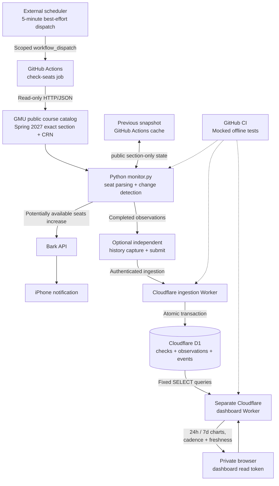

# Campus Seat Watch — portfolio architecture

This diagram documents the **deployed Spring 2027 implementation**, not a proposed auto-enrollment system. The monitoring job is scheduled externally and is best-effort. Both Cloudflare Workers are separately deployed. Only the read-only dashboard is intended for browser viewing.

## Important boundaries

- No student account login, enrollment, registration changes or CAPTCHA bypass.
- Bark **test** delivery to the iPhone was confirmed; the system has not claimed an observed *real* seat-opening alert.
- An observed 100% success rate means 100% **among stored checks**, not guaranteed completion of every scheduled trigger.
- Cloudflare ingestion and dashboard use distinct authentication secrets; the dashboard is a separate read-only query path.
- Historical source facts can still be lost if an ephemeral GitHub runner disappears before acknowledgment.
- The current monitored term and CRNs are fixed to Spring 2027; after registration ends, disable authorized live polling and use synthetic/archived demonstrations. [Term lifecycle](TERM_LIFECYCLE.md).
- Architecture updates in GitHub do **not** automatically redeploy the Cloudflare Workers.

## Demonstration without university traffic

Run `python monitor.py --demo` and `python demo_history.py` for local synthetic examples; run `python -m unittest discover -s tests -v` for mocked API, state-transition and notification-contract tests. No credentials or university requests are needed.
