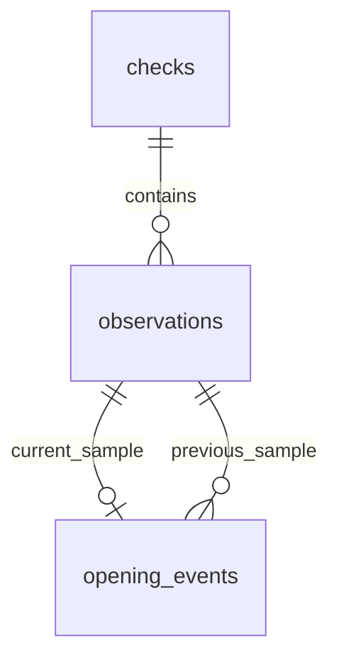

# SQLite historical seat tracking — Phase 3, Part 1

This is an offline library and synthetic demonstration. `monitor.py`,
`health_runner.py`, the live Actions workflow, cron-job.org, and Bark behavior
are unchanged. No production entry point imports the history module. The
implementation uses Python's built-in `sqlite3`; it adds no dependencies.

## Schema and relationships



| Table | Fields and role |
| --- | --- |
| `checks` | `check_id` text PK supplied by caller; `executed_at_utc`; `status` (`success`/`failed`); nonnegative `duration_seconds`; optional public `error_code`; `request_hash` for retry validation |
| `observations` | `observation_id` integer PK; `check_id` FK; `term`, `subject`, `course_number`, `section`, `crn`; nullable nonnegative `total_available` and `unreserved_available`; `reserved_summary_json`; `observed_at_utc`; `classification`; nonnegative `potential_available` |
| `opening_events` | `event_id` integer PK; unique `observation_id` FK to current sample; `previous_observation_id` FK to preceding sample; `previous_available`, strictly greater `new_available`; `detected_at_utc`; `classification` |

An event's course is obtained by joining its observation, avoiding duplicated
course identity fields. `(check_id, term, crn)` is unique. Term is required
because CRNs can be reused across terms. Indexes support check timestamps,
course history ordered by time, and event detection time. Foreign keys are
enabled on every library connection and prevent deletion of referenced rows.
Database constraints enforce statuses, nonnegative counts, event increases, and
event uniqueness; Python validation additionally enforces typed inputs and
consistent identity/order. All writes must use the library API to preserve
these additional invariants.

## Recording public observations

```python
from datetime import datetime, timezone
from seat_history import CourseObservation, SeatHistory

history = SeatHistory("local-history.sqlite3")
history.initialize()  # safe to call repeatedly; parent directory must exist
history.record_check(
    "offline-example-001", datetime.now(timezone.utc), 0.25,
    [CourseObservation("202710", "IT", "304", "DL1", "17582", 0,
                       "0 of 10 unreserved; 0 of 30 reserved")],
)
history.record_failure(
    "offline-example-002", datetime.now(timezone.utc), 20, "LOOKUP_TIMEOUT",
)
print(history.statistics())
print(history.latest("202710", "17582"))
print(history.history("202710", "17582"))
print(history.opening_events("202710", "17582"))
print(history.openings_by_day("202710", "17582"))
```

The caller records a completed check, supplying its UTC execution/sample time
(any aware datetime is normalized to UTC) and measured duration. All course
observations in that check share the timestamp. A future live adapter may need
individual course sample times if lookups span meaningful intervals. Successful
checks require observations. A partially failed check can include successful
course observations via `record_check(..., status="failed",
error_code="COURSE_LOOKUP_FAILED")`. Failed courses have no fabricated observations.

Use a stable check ID and the same timestamp, duration, status, error code, and
course facts when retrying a write. Exact retries return the existing check ID;
conflicting reuse raises `ValueError`. Equal observations on a later check are
retained as separate samples, without generating another opening event. A single
`BEGIN IMMEDIATE` transaction serializes writers and commits a check, all its
observations, and all events together. Validation or database failures roll back
the entire write. Connections close after each operation; database errors raise
`HistoryError` with a safe error category and retain the original exception as
the cause. There is a five-second busy timeout, no silent retry or data drop.

Append observations in increasing timestamp order per term/CRN. Backdated or
same-time observations under a different check ID are rejected, as are changes
to subject, course number, or section for the same term/CRN. An offline import
must sort its samples first. No migration/versioning framework is included yet;
future schema changes will need explicit migrations and backup/restore tests.

## Seat eligibility and missing data

The module reuses `monitor.alertable_open_seats` and `parse_unreserved` without
changing either function. `potential_available` is the comparison count:

| Public response | Classification | Potential count |
| --- | --- | --- |
| Total zero | `full` | 0 |
| Total positive, parseable positive unreserved count | `unreserved` | min(total, unreserved) |
| Total positive, no reservation summary | `possible` | total, with eligibility unverified |
| Total positive, explicit zero unreserved | `reserved_only` | 0 |
| Reservation restrictions cannot be parsed | `unknown` | 0, consistent with monitor |
| Total count missing | `unknown` | 0, but cannot establish an event baseline |

Unknown unreserved counts remain SQL NULL, not invented zero values. Invalid
negative, boolean, floating, or string total counts are rejected. Reserved
summaries may be public text (up to 2,000 characters), `None`, or a count-only
dictionary using `unreservedAvailable`, `unreservedRemaining`,
`reservedAvailable`, and `reservedRemaining`. Use `None` for an absent summary.
No raw API response is persisted.

The first observation establishes a baseline and creates no event, even if seats
are already available. This history-specific choice avoids claiming a detected
increase without a prior sample; production's cold-start notification behavior
is unchanged. A subsequent increase creates one `unreserved_increase` or
`possible_increase` event. Reserved-only changes are excluded. A restriction
changing from unknown to known availability can create an increase, matching
the monitor; that does not prove a new physical seat became available. Samples
with missing total counts break the comparison chain to avoid false openings.

## Historical SQL and analytics

`statistics()` runs SQL aggregates over completed checks: total, success, failure,
percentage success (NULL with no checks), observation count, and opening-event
count. A partial failure counts as a failed overall check. These metrics do not
measure Bark delivery or registration success.

`history()` and `latest()` query individual term/CRN histories using bound
parameters and timestamp ordering. `opening_events()` joins course identities.
`openings_by_day()` groups samples by **UTC detection date**, counts events, and
includes sampled days with zero events alongside sampling exposure. Days with
no samples are absent, rather than labeled as zero openings. For example:

```sql
SELECT substr(o.observed_at_utc, 1, 10) AS day_utc,
       COUNT(*) AS sampled_observations, COUNT(e.event_id) AS opening_events
FROM observations o LEFT JOIN opening_events e USING(observation_id)
WHERE o.term = ? AND o.crn = ?
GROUP BY day_utc ORDER BY day_utc;
```

These are observed increases between periodic samples, not exact opening times.
An opening may occur any time between samples; brief openings can be missed.
Long gaps and failed checks reduce coverage. One count increase is one event,
even if multiple seats appear. No rate per wall-clock hour or predictive claim
is made. A future dashboard can display course timelines, reserved eligibility
labels, check health, coverage gaps, and daily observed event counts through a
read-only API. It should retain these qualifications and paginate large histories.

## Offline validation

From the repository root, using Python 3.12:

```bash
python -m venv .venv
.venv/bin/python -m pip install -r requirements.txt
.venv/bin/python -m unittest discover -s tests -v
.venv/bin/python -m compileall -q monitor.py setup_bark.py health_runner.py seat_history.py demo_history.py tests
.venv/bin/python monitor.py --demo
.venv/bin/python demo_history.py
```

The SQLite demo creates and removes a temporary database containing synthetic
facts only. It prints four completed checks, three successes, one failure, 75%
success, six observations, and one event: IT 304 unreserved availability 0 → 1.
IT 341 reserved-only total availability 9 → 10 produces no event. It also prints
latest availability, histories, and daily SQL aggregates. Tests use temporary
databases; the demo test blocks HTTP requests and notification calls. Python CI
runs both demos, syntax checks, and all tests. The operational workflow is unchanged.

## Privacy and security

Only public course-level facts belong here. Never pass student identities,
account information, private enrollment data, credentials, or raw exception
messages. Error storage accepts only short uppercase category codes, not free
text or request URLs. Reserved-summary text must come from public course
information; the library cannot determine whether arbitrary text is private.
Dictionary keys are restricted to public seat counts. Check IDs must be opaque
identifiers, never secrets. SQL values use parameters.

SQLite files are unencrypted; protect local file permissions and future storage
access. Database/journal suffixes are gitignored as a guardrail, not a substitute
for reviewing commits. Do not commit real observations, publish database backups,
or expose raw database exceptions to a dashboard. Retention, access controls,
encryption at rest, backup recovery, and schema migrations must be designed
before live persistence. No registration or notification functionality is added.

## Later persistence architecture (proposal only)

A file on an ephemeral GitHub Actions runner is **not durable storage**.

| Option | Benefits | Limitations |
| --- | --- | --- |
| Actions cache | Convenient reuse of the latest small state snapshot | Eviction, immutable keys, stale restores and races; no transactional append or retention guarantee. Unsuitable as the history source of truth. |
| Workflow artifacts | Useful downloadable per-run audit/export snapshots | Retention expiry, explicit download/selection, multiple competing snapshots, no database transactions across runs. Useful for diagnostics or secondary exports, not the authoritative database. |
| Durable external storage | Explicit retention, backups, recovery and access control | Requires operational ownership, access configuration and concurrency handling; provider costs must be evaluated before adoption. |

For this small monitor, a practical next step is a **single writer on a persistent
host with SQLite on its durable local volume**, plus encrypted, versioned backups
in durable object storage. Use an existing host/free allocation only after
reviewing storage and recovery guarantees; no paid service is added here. Do not
share a live SQLite file over a network filesystem. Back up using SQLite's backup
API, not a blind copy during a write. Test restores and define retention before
calling it reliable.

If GitHub Actions remains the executor, a small authenticated ingestion service
can accept public check batches and stable idempotency keys and write to that
single SQLite owner (or a managed relational database if multiple writers are
needed). Grant least privilege, serialize writes, require acknowledged commits,
and record ingestion failures. OIDC/short-lived credentials are preferable where
supported. A lower-infrastructure alternative is downloading/uploading a SQLite
snapshot in object storage, but it requires one writer plus conditional object
version writes, integrity checks, and versioned backups to prevent lost updates;
it is more fragile than an owning ingestion service. Artifacts can remain
secondary exports; caches can remain performance aids. None of these live cloud
persistence paths is implemented in this phase.
