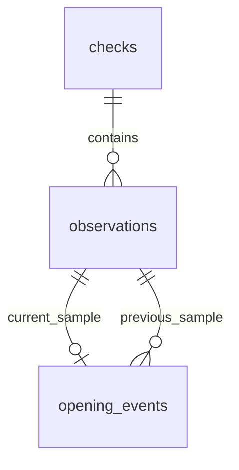

# Local SQLite history reference

`seat_history.py` provides the local transactional history model and an independent reference for Worker parity tests. It uses Python's built-in SQLite and adds no dependency. Its validation types are reused by capture, but production persistence uses Worker/D1 rather than a SQLite file on an Actions runner.

## Schema and relationships



| Table | Fields and role |
| --- | --- |
| `checks` | `check_id` text PK supplied by caller; `executed_at_utc`; `status` (`success`/`failed`); nonnegative `duration_seconds`; optional public `error_code`; `request_hash` for retry validation |
| `observations` | `observation_id` integer PK; `check_id` FK; `term`, `subject`, `course_number`, `section`, `crn`; nullable nonnegative `total_available` and `unreserved_available`; `reserved_summary_json`; `observed_at_utc`; `classification`; nonnegative `potential_available` |
| `opening_events` | `event_id` integer PK; unique `observation_id` FK to current sample; `previous_observation_id` FK to preceding sample; `previous_available`, strictly greater `new_available`; `detected_at_utc`; `classification` |

An event's course is obtained by joining its observation, avoiding duplicated
course identity fields. `(check_id, term, crn)` is unique. Term is required
because CRNs can be reused across terms. Indexes support check timestamps,
course history ordered by time, and event detection time. Foreign keys are
enabled on every library connection and prevent deletion of referenced rows.
Database constraints enforce statuses, nonnegative counts, event increases, and
event uniqueness; Python validation additionally enforces typed inputs and
consistent identity/order. All writes must use the library API to preserve
these additional invariants.

## Recording public observations

The following is a synthetic local API example, not catalog availability or production ingestion.

```python
from datetime import datetime, timezone
from seat_history import CourseObservation, SeatHistory

history = SeatHistory("local-history.sqlite3")
history.initialize()  # safe to call repeatedly; parent directory must exist
history.record_check(
    "offline-example-001", datetime.now(timezone.utc), 0.25,
    [CourseObservation("202710", "IT", "304", "DL1", "17582", 0,
                       "0 of 10 unreserved; 0 of 30 reserved")],
)
history.record_failure(
    "offline-example-002", datetime.now(timezone.utc), 20, "LOOKUP_TIMEOUT",
)
print(history.statistics())
print(history.latest("202710", "17582"))
print(history.history("202710", "17582"))
print(history.opening_events("202710", "17582"))
print(history.openings_by_day("202710", "17582"))
```

The caller records a completed check, supplying its UTC execution/sample time
(any aware datetime is normalized to UTC) and measured duration. All course
observations in that check share the timestamp. The deployed capture uses cycle-start time for all observations; individual lookup timestamps would require a protocol change. Successful
checks require observations. A partially failed check can include successful
course observations via `record_check(..., status="failed",
error_code="COURSE_LOOKUP_FAILED")`. Failed courses have no fabricated observations.

Use a stable check ID and the same timestamp, duration, status, error code, and
course facts when retrying a write. Exact retries return the existing check ID;
conflicting reuse raises `ValueError`. Equal observations on a later check are
retained as separate samples, without generating another opening event. A single
`BEGIN IMMEDIATE` transaction serializes writers and commits a check, all its
observations, and all events together. Validation or database failures roll back
the entire write. Connections close after each operation; database errors raise
`HistoryError` with a safe error category and retain the original exception as
the cause. There is a five-second busy timeout, no silent retry or data drop.

Append observations in increasing timestamp order per term/CRN. Backdated or
same-time observations under a different check ID are rejected, as are changes
to subject, course number, or section for the same term/CRN. An offline import
must sort its samples first. No migration/versioning framework is included yet;
future schema changes will need explicit migrations and backup/restore tests.

## Seat eligibility and missing data

The module reuses `monitor.alertable_open_seats` and `parse_unreserved` without
changing either function. `potential_available` is the comparison count:

| Public response | Classification | Potential count |
| --- | --- | --- |
| Total zero | `full` | 0 |
| Total positive, parseable positive unreserved count | `unreserved` | min(total, unreserved) |
| Total positive, no reservation summary | `possible` | total, with eligibility unverified |
| Total positive, explicit zero unreserved | `reserved_only` | 0 |
| Reservation restrictions cannot be parsed | `unknown` | 0, consistent with monitor |
| Total count missing | `unknown` | 0, but cannot establish an event baseline |

Unknown unreserved counts remain SQL NULL, not invented zero values. Invalid
negative, boolean, floating, or string total counts are rejected. Reserved
summaries may be public text (up to 2,000 characters), `None`, or a count-only
dictionary using `unreservedAvailable`, `unreservedRemaining`,
`reservedAvailable`, and `reservedRemaining`. Use `None` for an absent summary.
No raw API response is persisted.

The first observation establishes a baseline and creates no event, even if seats
are already available. This history-specific choice avoids claiming a detected
increase without a prior sample; production's cold-start notification behavior
is unchanged. A subsequent increase creates one `unreserved_increase` or
`possible_increase` event. Reserved-only changes are excluded. A restriction
changing from unknown to known availability can create an increase, matching
the monitor; that does not prove a new physical seat became available. Samples
with missing total counts break the comparison chain to avoid false openings.

## Historical SQL and analytics

`statistics()` runs SQL aggregates over completed checks: total, success, failure,
percentage success (NULL with no checks), observation count, and opening-event
count. A partial failure counts as a failed overall check. These metrics do not
measure Bark delivery or registration success.

`history()` and `latest()` query individual term/CRN histories using bound
parameters and timestamp ordering. `opening_events()` joins course identities.
`openings_by_day()` groups samples by **UTC detection date**, counts events, and
includes sampled days with zero events alongside sampling exposure. Days with
no samples are absent, rather than labeled as zero openings. For example:

```sql
SELECT substr(o.observed_at_utc, 1, 10) AS day_utc,
       COUNT(*) AS sampled_observations, COUNT(e.event_id) AS opening_events
FROM observations o LEFT JOIN opening_events e USING(observation_id)
WHERE o.term = ? AND o.crn = ?
GROUP BY day_utc ORDER BY day_utc;
```

These are observed increases between periodic samples, not exact opening times.
An opening may occur any time between samples; brief openings can be missed.
Long gaps and failed checks reduce coverage. One count increase is one event,
even if multiple seats appear. These aggregates do not predict future openings. The deployed dashboard provides
bounded timelines, classifications, health and coverage; daily analytics are available only through this local library.

## Offline validation

See [local tests and demonstrations](LOCAL_DEMO.md). `demo_history.py` creates a temporary synthetic database and exercises aggregate statistics, independent course histories and reservation-aware events. The demo blocks live requests and removes its temporary state. Fixture counts are examples, not current catalog availability.

## Privacy and security

Only public course-level facts belong here. Never pass student identities,
account information, private enrollment data, credentials, or raw exception
messages. Error storage accepts only short uppercase category codes, not free
text or request URLs. Reserved-summary text must come from public course
information; the library cannot determine whether arbitrary text is private.
Dictionary keys are restricted to public seat counts. Check IDs must be opaque
identifiers, never secrets. SQL values use parameters.

SQLite files are unencrypted; protect local file permissions and future storage
access. Database/journal suffixes are gitignored as a guardrail, not a substitute
for reviewing commits. Do not commit real observations, publish database backups,
or expose raw database exceptions to a dashboard. Persistent use of this local library requires explicit retention, access controls, storage protection, backup recovery and schema ownership. It does not issue registration actions or notifications.

## Relationship to D1

Local SQLite uses a `BEGIN IMMEDIATE` transaction and rejects newly backdated observations per term/CRN. D1 uses one Worker batch and schema 0002 neighbor-repair triggers to accept delayed observations. The HTTP protocol has stricter sanitization, bounded batches and UUID requirements; local and Worker request hashes are not interchangeable.

The local schema has no general migration framework. Future local schema changes need explicit upgrade and backup tests. A file on an ephemeral runner is not durable storage. Actions caches are comparison-state aids, and artifacts are temporary diagnostics rather than authoritative history. The selected external persistence and recovery design is documented in [D1 ingestion](CLOUDFLARE_DURABLE_HISTORY.md).
