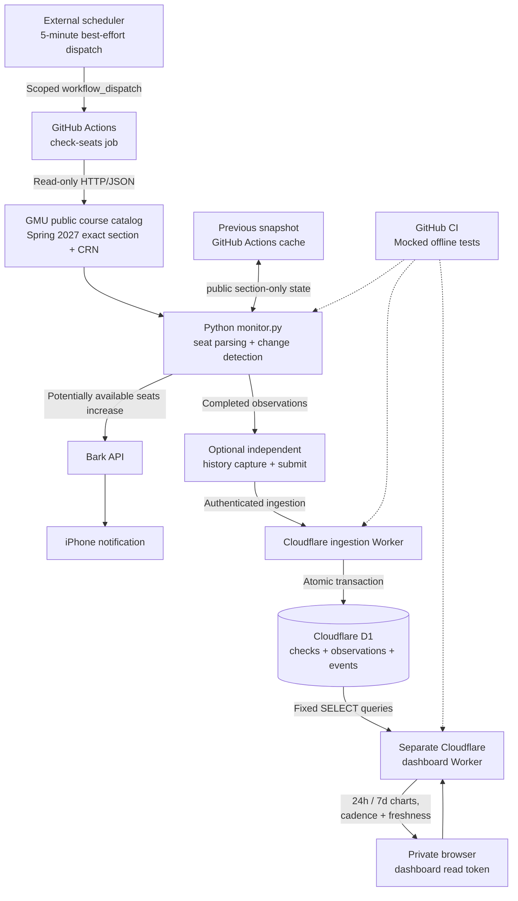

# GMU Seat Monitor — system diagram

The diagram shows the Spring 2027 monitoring workflow, state comparison, Bark notifications, D1 ingestion, and the separate historical dashboard.

## Service boundaries

- No student account login, enrollment, registration changes or CAPTCHA bypass.
- Cloudflare ingestion and dashboard use distinct authentication secrets; the dashboard is a separate read-only query path.
- Historical source facts can still be lost if an ephemeral GitHub runner disappears before acknowledgment.
- The current monitored term and CRNs are fixed to Spring 2027; disable live polling when it is no longer needed. [Term lifecycle](TERM_LIFECYCLE.md).
- Architecture updates in GitHub do **not** automatically redeploy the Cloudflare Workers.

## Offline verification

Run `python monitor.py --demo` and `python demo_history.py` for local synthetic examples; run `python -m unittest discover -s tests -v` for mocked API, state-transition and notification-contract tests. No credentials or university requests are needed.
